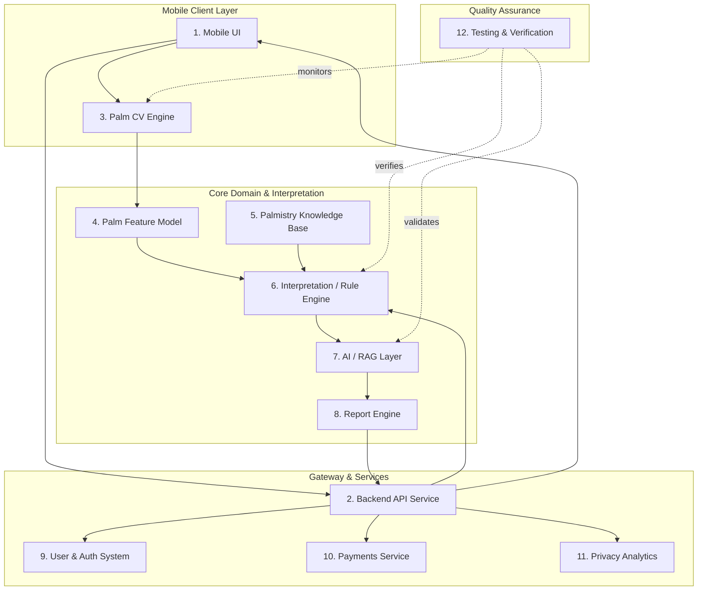
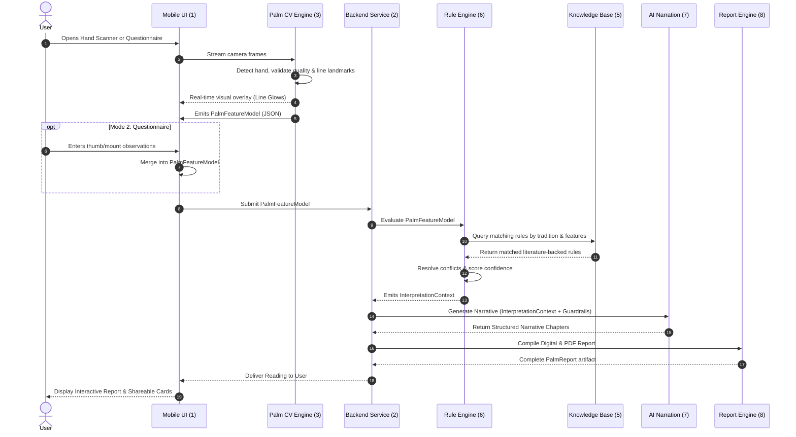

# Kai RegAI — System Architecture Specification

## 1. Architectural Philosophy & Core Axiom

The central technical requirement of Kai RegAI is strict architectural decoupling between computer vision, structured domain knowledge, deterministic rule evaluation, AI narrative generation, and user interface presentation.

```
       +-------------------------------------------------------------+
       |                     FORBIDDEN PIPELINE                      |
       |  [Raw Palm Image]  =====================>  [LLM]  ==> [Text]|
       +-------------------------------------------------------------+

                                     vs

       +-------------------------------------------------------------+
       |                     MANDATED PIPELINE                       |
       |                                                             |
       |   +------------------+                                      |
       |   | Raw Palm Image   |                                      |
       |   +--------+---------+                                      |
       |            |                                                |
       |            v                                                |
       |   +--------+---------+        +--------------------------+  |
       |   | Computer Vision  | -----> | Palm Feature Model (JSON)|  |
       |   +------------------+        +------------+-------------+  |
       |                                            |                |
       |                                            v                |
       |   +------------------+        +------------+-------------+  |
       |   | Knowledge Base   | -----> | Rule / Interp. Engine    |  |
       |   +------------------+        +------------+-------------+  |
       |                                            |                |
       |                                            v                |
       |                               +------------+-------------+  |
       |                               | Interpretation Context   |  |
       |                               +------------+-------------+  |
       |                                            |                |
       |                                            v                |
       |   +------------------+        +------------+-------------+  |
       |   | AI Narration LLM | -----> | Narrative Text Chapters  |  |
       |   +------------------+        +------------+-------------+  |
       |                                            |                |
       |                                            v                |
       |                               +------------+-------------+  |
       |                               | Report Engine & UI       |  |
       |                               +--------------------------+  |
       +-------------------------------------------------------------+
```

---

## 2. The 12 Subsystems & Module Boundaries

Kai RegAI consists of twelve distinct subsystems:



---

### Module 1: Mobile UI
* **Role**: Cross-platform client user interface delivering camera interactions, visual scanning effects, interactive questionnaires, and report viewers.
* **Responsibilities**:
  * Manage camera permissions and render high-performance viewfinder with OpenGL/Metal shaders.
  * Real-time guidance HUD (lighting indicators, alignment silhouettes).
  * 10-second scan choreography: laser beam sweep, dynamic line glows with standardized colors:
    * Life: Violet (`#8A2BE2`)
    * Head: Blue (`#3B82F6`)
    * Heart: Rose (`#F43F5E`)
    * Fate: Gold (`#F59E0B`)
    * Sun: Amber (`#D97706`)
  * Mode 2 guided questionnaire with visual selection controls (thumb angle, palm shape, mount firmness).
  * Interactive reading report presentation (tabbed chapters, card carousel, export modal).
* **Boundaries**: Contains **no interpretation logic**. UI simply invokes the CV engine and presents the data contracts supplied by the backend/report engine.

### Module 2: Backend API Service
* **Role**: Orchestrates client requests, secures data flow, enforces rate limits, and persists user state.
* **Responsibilities**:
  * Expose REST / gRPC / GraphQL endpoints for scanning sessions, questionnaire submissions, and report retrievals.
  * Manage session state, user tokens, and rate limits.
  * Coordinate calls to the Rule Engine, AI Narration Layer, and Report Engine.
* **Boundaries**: Strictly transport and orchestration. Does not embed raw palmistry rules or LLM prompt templates directly.

### Module 3: Palm Computer Vision Engine
* **Role**: On-device / edge image processing pipeline extracting spatial and geometric metrics from camera frames.
* **Responsibilities**:
  * Detect presence of a human hand and validate palmar (inner palm) vs dorsal (back of hand) view.
  * Detect hand orientation (Left vs Right hand, vertical alignment $\pm 15^\circ$).
  * Real-time image quality evaluation: sharpness metric, exposure/lighting balance, occlusion detection.
  * Landmark localization: 21 standard skeletal hand landmarks + palm contour points.
  * Perspective rectification: Warps palm surface to a normalized 2D plane.
  * Crease tracing: Segments major palmar creases (Life, Head, Heart, Fate, Sun lines) as Bézier / spline coordinates.
  * Mount spatial profiling: Identifies bounding regions for the 8 traditional mounts (Jupiter, Saturn, Sun/Apollo, Mercury, Upper Mars, Lower Mars, Venus, Moon).
* **Boundaries**: Emits geometric and topological features only. Contains **no astrological, palmistry, or symbolic interpretations**.

### Module 4: Palm Feature Model (Canonical Data Contract)
* **Role**: The single source of truth data schema representing extracted hand characteristics.
* **Contract Specification** (Structured JSON):
  ```json
  {
    "hand": {
      "side": "RIGHT",
      "type": "DOMINANT",
      "proportions": {
        "palm_ratio": 1.05,
        "finger_to_palm_ratio": 0.82,
        "elemental_shape": "EARTH"
      }
    },
    "lines": {
      "life_line": {
        "present": true,
        "length_score": 0.88,
        "depth": "DEEP",
        "curvature": "WIDE_ARC",
        "origin": "BETWEEN_JUPITER_AND_THUMB",
        "branches": ["ASCENDING_TO_JUPITER"],
        "breaks": []
      },
      "head_line": {
        "present": true,
        "length_score": 0.76,
        "depth": "CLEAR",
        "curvature": "SLIGHT_SLOPE_TO_MOON",
        "separation_from_life_line": "SLIGHTLY_JOINED"
      },
      "heart_line": {
        "present": true,
        "length_score": 0.81,
        "depth": "MODERATE",
        "curvature": "CURVED_TOWARD_JUPITER",
        "termination": "BETWEEN_JUPITER_AND_SATURN"
      },
      "fate_line": {
        "present": true,
        "length_score": 0.65,
        "origin": "BASE_OF_PALM",
        "termination": "MOUNT_OF_SATURN"
      },
      "sun_line": {
        "present": true,
        "length_score": 0.45,
        "depth": "FAINT",
        "termination": "MOUNT_OF_SUN"
      }
    },
    "mounts": {
      "jupiter": { "prominence": "WELL_DEVELOPED", "offset": "CENTERED" },
      "saturn": { "prominence": "NORMAL", "offset": "CENTERED" },
      "sun": { "prominence": "NORMAL", "offset": "CENTERED" },
      "mercury": { "prominence": "WELL_DEVELOPED", "offset": "SLIGHT_LATERAL" },
      "venus": { "prominence": "FULL", "firmness": "FIRM" },
      "moon": { "prominence": "MODERATE", "firmness": "NORMAL" }
    },
    "user_observations": {
      "thumb_flexibility": "SUPPLE",
      "skin_texture": "FINE",
      "palm_flexibility": "ELASTIC"
    }
  }
  ```

### Module 5: Palmistry Knowledge Base
* **Role**: Structured repository of traditional palmistry rules derived exclusively from researched literature.
* **Responsibilities**:
  * Encapsulates rules across Classical Indian (*Hasta Samudrika Shastra*), Modern Indian, and Historical Western traditions.
  * Every rule contains explicit metadata:
    * `rule_id`: Unique identifier
    * `tradition`: `HASTA_SAMUDRIKA` | `WESTERN_CLASSICAL` | `MODERN_SYNTHESIS`
    * `source_literature`: Author, Title, Chapter/Section reference
    * `conditions`: Boolean/Threshold criteria matching `PalmFeatureModel`
    * `thematic_tags`: `CAREER`, `RELATIONSHIPS`, `VITALITY`, `INTELLECT`, `TEMPERAMENT`
    * `significance`: Core symbolic meaning and reflective insight
    * `confidence_weight`: Historical consensus score (0.0 – 1.0)
* **Boundaries**: Read-only reference knowledge graph. Zero programmatic execution logic.

### Module 6: Interpretation / Rule Engine
* **Role**: Deterministic evaluation engine matching canonical `PalmFeatureModel` against the `Palmistry Knowledge Base`.
* **Responsibilities**:
  * Execute deterministic matching algorithms without LLM involvement.
  * Resolve conflicting signs (e.g., strong line vs contradictory mount shape) via weighted hierarchy rules.
  * Differentiate Dominant Hand (current trajectory/conscious effort) vs Non-Dominant Hand (innate blueprint/subconscious predisposition).
  * Assemble the unified `InterpretationContext` object containing identified traits, primary themes, traditional citations, and confidence ratings.
* **Boundaries**: Strictly deterministic and reproducible. Given the same `PalmFeatureModel`, it will produce the exact same `InterpretationContext`.

### Module 7: AI / RAG Layer
* **Role**: Controlled natural language generation and narration engine.
* **Responsibilities**:
  * Accepts `InterpretationContext` and constructs structured, empathetic, culturally respectful narrative chapters.
  * Employs retrieval-augmented templates to weave together traditional Vedic insights and Western character analysis.
  * Enforces strict safety guardrails: strips predictive fatalism, prohibits medical or financial advice, emphasizes reflective self-discovery.
* **Boundaries**: Strictly narrative generation. The AI is **forbidden from inventing new palm traits** or altering the rule engine's findings.

### Module 8: Report Engine
* **Role**: Formats and packages interpreted results into consumable digital and physical artifacts.
* **Responsibilities**:
  * Assembles dynamic in-app reading views (overview cards, interactive line guides, chapter cards).
  * Generates high-resolution branded PDF reports suitable for printing or saving.
  * Generates shareable image cards optimized for messaging and social channels.

### Module 9: User & Authentication System
* **Role**: Secure account lifecycle, privacy controls, and data management.
* **Responsibilities**:
  * Support Apple Sign-In, Google Sign-In, and ephemeral guest mode.
  * Store user profiles, birth details (for Vedic astrological cross-reference if opted-in), and reading history.
  * Manage data retention policies with one-click palm data deletion.

### Module 10: Payments & Monetization
* **Role**: Handles in-app purchase validation, subscriptions, and entitlement management.
* **Responsibilities**:
  * Manage StoreKit 2 (iOS) and Google Play Billing (Android) transactions.
  * Maintain subscription tiers: Free Scanner vs Premium In-Depth Palm Dossier.
  * Server-side cryptographic receipt validation.

### Module 11: Privacy & Analytics
* **Role**: Telemetry, usage insights, and funnel conversion tracking without capturing sensitive biometrics.
* **Responsibilities**:
  * Track app health, crash metrics, scan drop-off rates, and user retention.
  * Zero logging of raw images or identifiable biometric landmark arrays to analytics backends.

### Module 12: Testing & Verification Infrastructure
* **Role**: Automated quality assurance, regression testing, and precision benchmarking.
* **Responsibilities**:
  * Unit test suite for deterministic rule engine.
  * CV regression dataset containing labeled palm images across lighting and demographic variations.
  * LLM evaluation harness verifying that AI narrations never introduce hallucinated palm traits.

---

## 3. Data Flow Diagram


