# Kai RegAI — Deployment & Operations Specification

## 1. Target Platforms & Distribution Channels

Kai RegAI is architected for dual-platform mobile deployment alongside a scalable cloud backend.

```
                                  +-------------------+
                                  |    Source Repo    |
                                  +---------+---------+
                                            |
                      +---------------------+---------------------+
                      |                                           |
                      v                                           v
           +--------------------+                      +--------------------+
           |  iOS Client Target |                      |   Android Target   |
           |  (Apple App Store) |                      | (Google Play Store)|
           +--------------------+                      +--------------------+
                      \                                           /
                       \                                         /
                        v                                       v
                     +---------------------------------------------+
                     |         Cloud Backend Infrastructure        |
                     |  (API Gateway, Auth, Rules, AI Narration)   |
                     +---------------------------------------------+
```

| Component | Target Platform | Primary Technologies | Distribution / Hosting |
|---|---|---|---|
| **Mobile Client** | iOS 16.0+ | React Native / Native Shell, Metal/OpenGL Shaders, CoreML | Apple App Store / TestFlight |
| **Mobile Client** | Android 10.0+ (API 29+) | React Native / Native Shell, Vulkan/GLES, TFLite/NNAPI | Google Play Store / Internal Track |
| **Backend API** | Cloud Containerized | Node.js / TypeScript, Fastify/NestJS, Docker | AWS ECS / GCP Cloud Run |
| **Rule Engine** | Microservice / Serverless | TypeScript / Rust / Python worker | Serverless / Cloud Functions |
| **Database & Cache**| Managed Cloud | PostgreSQL (with JSONB), Redis | Managed AWS RDS / Supabase |

---

## 2. Privacy, Biometrics & Store Policy Compliance

Because palm imagery involves sensitive personal data, deployment and release must conform to rigorous legal and store guidelines:

### A. Apple App Store Guidelines Compliance
* **Guideline 5.1.1 (Data Collection & Storage)**:
  * Camera usage purpose string must be explicitly descriptive:
    * `NSCameraUsageDescription`: *"Kai RegAI uses your camera exclusively in real time to detect palm lines and hand geometry for your palm reading. Raw palm images are processed on your device and are never stored or uploaded without your explicit permission."*
* **Guideline 4.3 / 4.7 (Fortune Telling & Entertainment Apps)**:
  * Apps offering astrology, palmistry, or horoscopes must explicitly disclose their entertainment/reflective nature.
  * The app listing, onboarding, and terms must state: *"Kai RegAI is designed for entertainment and personal reflection based on traditional palmistry traditions. It does not provide medical, legal, or financial advice."*
* **In-App Purchase (Guideline 3.1.1)**:
  * All digital reading purchases, premium tier unlocks, and extended reports must process through Apple In-App Purchase (StoreKit 2).

### B. Google Play Store Policy Compliance
* **Biometric & Sensitive Data Policy**:
  * Hand measurements and palm landmarks fall under sensitive user data. Must complete the Google Play Data Safety form with zero third-party data sharing for ad networks.
* **Camera Permission Scope**:
  * Camera permission is requested strictly just-in-time when launching the scanner, never on cold app start.
* **Google Play Billing**:
  * Full integration with Google Play Billing Library v6+ for subscriptions and digital purchases.

### C. Regional Privacy Regulations
* **GDPR (European Union)** & **CCPA/CPRA (California)**:
  * Right to erasure: A single-tap *"Delete All My Palm Data"* button must be accessible within App Settings.
  * Zero persistent storage of raw palm photographs on server disks. Once the `PalmFeatureModel` is parsed, camera frame buffers are immediately evicted from RAM.
* **Digital Personal Data Protection (DPDP) Act (India)**:
  * Appropriate disclosures given the deep integration of Indian *Hasta Samudrika* cultural lore.
  * Clear consent mechanisms for account creation and reading storage.

---

## 3. Environment Strategy & Configuration

Three isolated environments must be maintained:

```
[Development (dev)] ──> [Staging / QA (staging)] ──> [Production (prod)]
```

| Environment | Purpose | Mobile Distribution | Backend Domain |
|---|---|---|---|
| **Development** | Daily feature work, mock CV feeds, sandbox LLM | Local simulator & debug builds | `https://api-dev.kaireg.ai` |
| **Staging** | End-to-end integration, real camera testing, QA matrix | TestFlight (iOS) & Google Internal Testing | `https://api-staging.kaireg.ai` |
| **Production** | Live end-user traffic, official releases | App Store & Google Play Production Tracks | `https://api.kaireg.ai` |

---

## 4. CI/CD Pipeline & Automated Gates

Every commit and release tag must pass through automated verification:

```mermaid
graph LR
    Commit[Git Commit / PR] --> Linter[Lint & Typecheck]
    Linter --> UnitTests[Rule Engine Unit Tests]
    UnitTests --> GuardrailTest[AI Safety Verification]
    GuardrailTest --> BuildMobile[Fastlane Mobile Build]
    BuildMobile --> DeployStaging[Staging / TestFlight]
    DeployStaging --> ManualApproval[Phase Gate Approval]
    ManualApproval --> ProductionDeploy[Production Release]
```



1. **Lint & Typecheck**: ESLint, TypeScript `tsc --noEmit`, strict null-safety checks.
2. **Deterministic Rule Suite**: 100% pass on canonical hand feature test matrices.
3. **AI Guardrail Regression Test**: Runs synthetic dirty inputs (e.g., prompt injection, health diagnosis requests) to ensure 0% policy violation.
4. **Fastlane Pipeline**: Automated signing, provisioning profile management, and upload to App Store Connect and Google Play Console.
