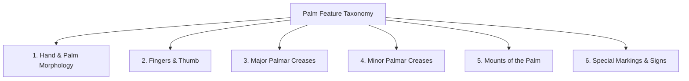

# Kai RegAI — Palmistry Knowledge Architecture

## 1. Core Knowledge Principle

```
+-------------------------------------------------------------------------------+
|                             KNOWLEDGE PIPELINE                                |
|                                                                               |
|  Researched Literature & Texts                                                |
|         │                                                                     |
|         ▼                                                                     |
|  Structured Knowledge Base (Taxonomy, Ontologies, Source Records)             |
|         │                                                                     |
|         ▼                                                                     |
|  Source Attribution & Tradition Partitioning (Vedic vs Western vs Modern)    |
|         │                                                                     |
|         ▼                                                                     |
|  Deterministic Rule Engine (Conditional Logic & Conflict Resolution)          |
|         │                                                                     |
|         ▼                                                                     |
|  Targeted Context Retrieval                                                   |
|         │                                                                     |
|         ▼                                                                     |
|  AI Narration & Synthesis Layer (Empathetic, Guardrailed Presentation)        |
+-------------------------------------------------------------------------------+
```

### Strict Non-Negotiable Directives
1. **Never Invent Palmistry Rules**: AI agents and engineers are strictly forbidden from creating speculative or ungrounded palmistry interpretations.
2. **Never Fabricate Sources or Citations**: All knowledge entries must link to verified literature, classical commentaries, or historical treatises.
3. **Never Blindly Merge Contradictory Traditions**: Classical Indian (*Hasta Samudrika*) and Historical Western traditions often interpret the same feature differently (e.g., Mount of Mars upper/lower divisions; meaning of line breaks). These traditions must be preserved as distinct, tagged perspectives.
4. **No Direct LLM Fine-Tuning on Raw Palmistry Texts**: Do not treat the LLM as an unconstrained palmistry database. Knowledge lives in structured, inspectable schemas (JSON/YAML or relational/graph models); the LLM is exclusively a language synthesis layer.

---

## 2. Supported Palmistry Traditions

Kai RegAI recognizes three distinct tradition families:

### A. Classical Indian (*Hasta Samudrika Shastra*)
* **Foundational Framework**: Part of the *Samudrika Shastra* (body feature interpretation) within Vedic traditions.
* **Core Emphases**:
  * **Chirognomy & Hand Types**: Elemental balance (*Pancha Mahabhuta*: Prithvi/Earth, Jala/Water, Agni/Fire, Vayu/Air, Akasha/Ether).
  * **Auspicious & Inauspicious Signs (*Lakshanas*)**: *Trishula* (trident), *Matsya* (fish), *Padma* (lotus), *Chakra* (wheel), *Dhwaja* (flag), *Shankha* (conch).
  * **Thumb Primacy**: The thumb (*Angustha*) is regarded as the anchor of the whole hand; divisions of willpower (*Atma/Ichha Shakti*) and logic/reasoning (*Jnana/Tarka Shakti*).
  * **Mount Associations**: Strong link between planetary mounts (*Grahas*) and karmic tendencies.

### B. Historical Western Palmistry
* **Foundational Framework**: 19th and early 20th-century classical systems codified by figures such as Cheiro (Count Louis Hamon), William G. Benham, and Desbarrolles.
* **Core Emphases**:
  * **Characterology & Temperament**: Psychological motivations, temperament types (nervous, bilious, sanguine, lymphatic).
  * **Line Morphology**: Depth, clarity, color, chaining, islands, bars, and splits along the three major primary lines (Life, Head, Heart).
  * **Fate & Sun Line Dynamics**: Career trajectory, public recognition, artistic capacity, and personal drive.

### C. Modern & Reflective Palmistry
* **Foundational Framework**: Mid-to-late 20th-century integrative frameworks (e.g., dermatoglyphics, psychological chirology, Charlotte Wolff, Edward Campbell).
* **Core Emphases**:
  * Self-reflection, emotional integration, stress patterns, and conscious evolution rather than fatalistic prediction.
  * Dominant hand (active evolution / choices made) versus Passive hand (innate wiring / latent potential).

---

## 3. Palm Feature Taxonomy & Ontology

The Knowledge Base categorizes all palm features into six canonical domains:



### 1. Hand & Palm Morphology
* **Elemental Shapes**: Earth Hand (square palm, short fingers), Air Hand (square palm, long fingers), Fire Hand (oblong palm, short fingers), Water Hand (oblong palm, long fingers).
* **Skin Texture**: Fine (sensitive, receptive), Medium (balanced), Coarse/Robust (pragmatic, physical).
* **Palm Elasticity/Flexibility**: Stiff (cautious, methodical), Elastic (adaptable, resilient), Flaccid/Overly Supple (impressionable, impressionable).

### 2. Fingers & Thumb (*Angustha & Anguli*)
* **Thumb Structure**:
  * Angle of setting: Wide angle ($\approx 90^\circ$, independent, adventurous) vs narrow angle ($<45^\circ$, cautious, reserved).
  * Flexibility: Supple thumb (generous, adaptable) vs Stiff thumb (resolute, disciplined, stubborn).
  * Phalange balance: First phalange (Willpower) vs Second phalange (Logic/Discernment).
* **Fingers**:
  * Index finger (*Tarjani* / Jupiter): Leadership, ambition, spiritual aspiration.
  * Middle finger (*Madhyama* / Saturn): Discipline, introspection, duty, structure.
  * Ring finger (*Anamika* / Sun / Apollo): Creativity, public expression, aesthetic sensitivity.
  * Little finger (*Kanishtha* / Mercury): Communication, commercial acumen, articulate expression.

### 3. Major Palmar Creases
* **Life Line (*Pitri Rekha* / Line of Vitality)**:
  * Course, breadth, depth, origin near Jupiter vs thumb, curvature around Mount of Venus.
* **Head Line (*Matri Rekha* / Line of Mentality)**:
  * Straight (practical, linear logic) vs sloping (imaginative, creative synthesis); joined to or separated from Life Line at origin.
* **Heart Line (*Ayush/Hridaya Rekha* / Line of Emotion)**:
  * Curved upward to Jupiter (idealistic, devoted) vs straight across palm (contained, pragmatic); single line vs double line.

### 4. Minor Palmar Creases
* **Fate Line (*Urdhwa Rekha* / Line of Saturn / Destiny)**: Presence, continuity, starting point (wrist, Moon, Life line).
* **Sun Line (*Surya Rekha* / Apollo / Line of Fame)**: Clarity, origin, presence under Apollo mount.
* **Mercury Line (*Budha Rekha* / Health / Hepatica)**: Quality, digestive/nervous indicators.
* **Girdle of Venus (*Shukra Valaya*)**: Emotional sensitivity, aesthetic intensity.
* **Relationship / Union Lines (*Vivaha Rekha*)**: Lateral lines on the percussion of Mercury.

### 5. Mounts of the Palm (*Parvatas*)
* **Mount of Jupiter (*Guru*)**: Ambition, wisdom, leadership, benevolence.
* **Mount of Saturn (*Shani*)**: Sobriety, philosophical bent, discipline, solitude.
* **Mount of Apollo / Sun (*Surya*)**: Artistry, radiance, optimism, charisma.
* **Mount of Mercury (*Budha*)**: Eloquence, insight, trade, scientific or relational agility.
* **Upper Mars (*Agni/Mangala*)**: Moral courage, endurance, steadfastness.
* **Lower Mars (*Mangala*)**: Physical courage, assertiveness, initiative.
* **Mount of Venus (*Shukra*)**: Vitality, sensuality, empathy, aesthetic love.
* **Mount of Moon (*Chandra*)**: Intuition, imagination, subconscious depth, travel.

### 6. Special Markings & Signs (*Chihnas / Signs*)
* **Vedic Signs**: *Trishula* (trident), *Matsya* (fish), *Padma* (lotus), *Temple/Square* (protection), *Star* (sudden intensification).
* **Structural Signs**: Crosses, Grilles, Islands, Bars, Dots, Triangles, Rings (Ring of Solomon, Ring of Saturn).

---

## 4. Structured Rule Representation Schema

Every palmistry rule in Kai RegAI must conform to this JSON/YAML contract:

```json
{
  "$schema": "https://kaireg.ai/schemas/knowledge-rule.v1.json",
  "rule_id": "KB-HS-LIF-0042",
  "name": "Life Line Wide Arc Surrounding Full Venus Mount",
  "tradition": "HASTA_SAMUDRIKA",
  "tradition_category": "CLASSICAL_INDIAN",
  "sources": [
    {
      "author": "Dr. Narayan Dutt Shrimali",
      "title": "Practical Palmistry",
      "chapter": "The Life Line and Mount of Venus",
      "page_reference": "pp. 54-58",
      "edition": "English Translation Rev. 2002"
    },
    {
      "author": "Cheiro (Count Louis Hamon)",
      "title": "Palmistry for All",
      "chapter": "Chapter IV: The Line of Life",
      "corroboration_type": "WESTERN_EQUIVALENT"
    }
  ],
  "confidence_level": 0.95,
  "conditions": {
    "all_of": [
      { "feature": "lines.life_line.present", "operator": "EQUALS", "value": true },
      { "feature": "lines.life_line.curvature", "operator": "EQUALS", "value": "WIDE_ARC" },
      { "feature": "mounts.venus.prominence", "operator": "IN", "value": ["WELL_DEVELOPED", "FULL"] }
    ]
  },
  "interpretation": {
    "theme": "VITALITY_AND_EMPATHY",
    "reflective_insight": "A generous curve around the Mount of Venus signifies a warm, expansive nature with a strong reserve of physical stamina and an openhearted approach to community and family ties.",
    "traditional_terms": ["Purna Ayu Lakshana", "Balavan Shukra"],
    "positive_traits": ["Warmheartedness", "Enduring vitality", "Generosity", "Affectionate disposition"],
    "cautionary_aspects": ["Risk of overextending personal energy on behalf of others"]
  },
  "narrative_cues": {
    "tone": "Warm, inspiring, grounded",
    "keywords": ["vitality", "warmth", "expansion", "stamina"]
  }
}
```

---

## 5. Conflict Resolution & Multi-Tradition Synthesis

When two traditions or signs yield differing meanings for the same feature combination:
1. **Never Silently Erase Differences**: The system must surface both perspectives if meaningful. Example:
   * *“In the classical Indian tradition (Hasta Samudrika), this marking near the Mount of Jupiter is often contemplated as a symbol of divine protection (Raksha Rekha). Historical Western palmists (such as Benham) interpret this same intersection as an index of focused scholarly ambition.”*
2. **Hierarchy of Influence**:
   * **Hand Shape & Thumb** provide the base constitutional substrate.
   * **Mounts** provide energetic intensity.
   * **Lines** show how that energy is channeled.
   * **Special Marks** act as local modifiers or accentuations.
3. **No Unchecked Fatalism**: If a classical text lists an ominous or catastrophic outcome, modern reflective re-framing is applied (e.g., transforming "sudden misfortune" into "a transformative period urging introspection and intentional recalibration").
