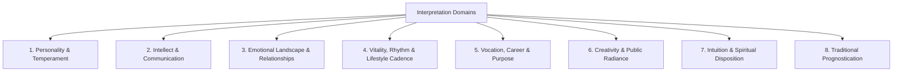

# Kai RegAI — Interpretation Rule Model

## 1. The Mandatory Boundary: Observation vs. Interpretation

A foundational law of Kai RegAI is the absolute architectural separation between **Physical Observations** and **Symbolic Interpretations**.

```
+-------------------------------------------------------------+
|                     OBSERVATION LAYER                       |
|  Physical Fact: "Life Line is continuous and forms a wide   |
|  arc of radius 42mm with no observable transverse breaks."  |
+-------------------------------------------------------------+
                               │
                               ▼
+-------------------------------------------------------------+
|                    INTERPRETATION LAYER                     |
|  Traditional Hermeneutic: "Classical traditions correlate   |
|  a wide, unencumbered Life Line arc with robust vitality,   |
|  openhearted empathy, and grounded physical stamina."       |
+-------------------------------------------------------------+
```

### Directives:
1. **Never conflate observation with meaning**: An image processing engine cannot detect "leadership"; it detects an index finger that equals or exceeds the ring finger in length.
2. **Independent evolution**: The observation engine can be upgraded (e.g., from 2D segmentation to 3D mesh depth) without invalidating historical rule logic.

---

## 2. Interpretation Rule Schema Specification

Every production rule is serialized in structured JSON adhering to `knowledge/schema/interpretation_rule.schema.json`:

```json
{
  "$schema": "https://kaireg.ai/schemas/interpretation-rule.v1.json",
  "rule_id": "RULE-HEAD-0014",
  "name": "Head Line Gentle Slope Towards Mount of Moon",
  "tradition": "WESTERN_HISTORICAL",
  "tradition_category": "HISTORICAL_CLASSICAL",
  "sources": [
    {
      "source_id": "SRC-WST-001",
      "author": "William G. Benham",
      "work": "The Laws of Scientific Hand Reading",
      "chapter": "The Head Line",
      "page_reference": "pp. 230-234",
      "authority_level": "LEVEL_3"
    },
    {
      "source_id": "SRC-WST-002",
      "author": "Cheiro",
      "work": "Palmistry for All",
      "chapter": "Chapter V: The Line of Head",
      "page_reference": "pp. 42-45",
      "authority_level": "LEVEL_3"
    }
  ],
  "consensus_status": "MULTI_SOURCE_AGREEMENT",
  "conditions": {
    "all_of": [
      {
        "feature_path": "lines.head_line.presence",
        "operator": "EQUALS",
        "target_value": true
      },
      {
        "feature_path": "lines.head_line.curvature_profile",
        "operator": "IN",
        "target_value": ["GENTLE_SLOPE", "SLIGHT_CURVE_TO_MOON"]
      },
      {
        "feature_path": "lines.head_line.continuity",
        "operator": "EQUALS",
        "target_value": "CONTINUOUS"
      }
    ]
  },
  "interpretation": {
    "primary_domain": "INTELLECT_AND_COMMUNICATION",
    "secondary_domains": ["CREATIVITY_AND_EXPRESSION", "PERSONALITY_AND_TEMPERAMENT"],
    "traditional_archetype": "The Imaginative Realist / Pragmatic Visionary",
    "traditional_terms": ["Matri Rekha Chandra Gamini", "Sloping Head Line"],
    "reflective_synthesis": "Your thought process harmonizes analytical reasoning with intuitive imagination. You are capable of abstract, creative ideation while retaining the practical ability to execute ideas in the tangible world.",
    "character_strengths": [
      "Intuitive problem-solving",
      "Creative articulation",
      "Adaptable mental focus"
    ],
    "mindfulness_cautions": [
      "Risk of over-romanticizing possibilities when rigorous data is required"
    ]
  },
  "confidence_profile": {
    "source_authority_score": 0.90,
    "traditional_consensus_score": 0.95,
    "rule_robustness": 0.92
  }
}
```

---

## 3. Domain Taxonomy for Interpretations

All interpretations are partitioned into eight life domains, establishing clear demarcation between psychological/reflective self-inquiry and archaic fortune-telling:



### Domain Delineations:
1. **`PERSONALITY_AND_TEMPERAMENT`**: Constitutional temperament (Earth/Air/Fire/Water, Choleric/Sanguine), introversion vs extroversion, patience vs dynamism.
2. **`INTELLECT_AND_COMMUNICATION`**: Reasoning cadence, linear vs lateral logic, analytical rigor, verbal and written expression.
3. **`EMOTION_AND_RELATIONSHIPS`**: Attachment style, emotional vulnerability, empathy, devotion, relational boundaries.
4. **`VITALITY_AND_LIFESTYLE`**: Constitutional energy reserves, stamina, recovery rhythm, somatic grounding.
5. **`VOCATION_AND_PURPOSE`**: Self-direction vs institutional career, leadership drive, diligence, long-term discipline.
6. **`CREATIVITY_AND_RADIANCE`**: Aesthetic sensibility, personal magnetism, public visibility, artistic inclination.
7. **`INTUITION_AND_SPIRITUALITY`**: Philosophical contemplation, intuitive perception, affinity for cultural/mystical study.
8. **`TRADITIONAL_PROGNOSTICATION`**:
   * *Special Quarantine Category*: Contains historical omens (*Lakṣaṇas*) from primary Sanskrit texts.
   * *Mandatory Transformation*: In the user-facing report, items in this domain are explicitly prefaced with historical framing: *"Historically, classical Samudrika texts contemplated this sign as..."* and translated into constructive personal reflection.

---

## 4. Multi-Source Consensus Classifications

Every rule is evaluated and tagged with an agreement level:

| Classification | Definition | Rule Weight Multiplier |
|---|---|---|
| `MULTI_SOURCE_AGREEMENT` | Multiple authoritative sources across traditions corroborate the interpretation (e.g. Benham and Shrimali agree on wide Life Line). | $1.20$ |
| `SINGLE_SOURCE` | Documented by only one reputable classical or historical text (e.g. specific verse in *Hastasañjīvana*). | $0.85$ |
| `TRADITION_SPECIFIC` | Valid exclusively within a specific tradition (e.g. *Yava* sign on thumb in *Hasta Samudrika*). | $1.00$ (Active only when tradition enabled) |
| `TRADITION_CONFLICT` | Sources present conflicting conclusions for the same feature configuration. | Handled via [CONFLICT_MODEL.md](file:///Users/Hp/Documents/Kai%20RegAI%20%28clone%29/docs/p1/CONFLICT_MODEL.md) |
