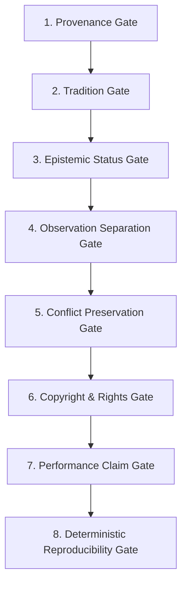

# Kai RegAI — P1 Knowledge System Quality Gates

This document defines the mandatory automated and manual verification gates that every knowledge rule, source record, taxonomy item, and architectural schema must clear before deployment.

---

## 1. The Eight Core Quality Gates



### Gate 1: Provenance & Attribution Integrity
* **Requirement**: Every interpretation rule and pattern combination must retain at least one valid, immutable `source_id` referencing a verified catalog entry in `knowledge/sources/sources.json`.
* **Validation Rule**:
  $$\forall r \in \text{Rules}, \quad r.\text{sources} \neq \emptyset \quad \land \quad \forall s \in r.\text{sources}, s.\text{source\_id} \in \text{SourceRegistry}$$
* **Rejection Criteria**: Rules citing vague or anonymous sources (e.g. *"Ancient tradition says"*, *"Web astrologers claim"*) are rejected immediately.

### Gate 2: Tradition Classification
* **Requirement**: Every knowledge entity must explicitly declare its tradition origin:
  * `CLASSICAL_INDIAN`
  * `MODERN_INDIAN`
  * `WESTERN_HISTORICAL`
  * `MODERN_WESTERN`
  * `COMPARATIVE`
* **Validation Rule**: Rules must not merge traditions in the source record. Multi-tradition combinations must reside exclusively in the `KAI_REGAI_SYNTHESIS` namespace.

### Gate 3: Epistemic Status Classification
* **Requirement**: Every rule and source must be tagged with its precise epistemic nature:
  * `HISTORICAL_TEXT`: Primary classical manuscripts and public domain historical books.
  * `SCHOLARLY_ANALYSIS`: Peer-reviewed academic critical editions and Indological papers.
  * `TRADITIONAL_INTERPRETATION`: Symbolic hermeneutic claims with literary provenance.
  * `MODERN_PRACTITIONER`: 20th/21st-century published manuals.
  * `SCIENTIFIC_EVIDENCE`: Strictly reserved for empirical, peer-reviewed anatomy or CV metrics.
  * `MODERN_SYNTHESIS`: Proprietary Kai RegAI composite formulations.
* **Prohibition**: Historical palmistry manuals (such as Benham’s *The Laws of Scientific Hand Reading*) must **never** be tagged as `SCIENTIFIC_EVIDENCE`.

### Gate 4: Observation vs. Interpretation Separation
* **Requirement**: Physical metrics must flow through the canonical 5-stage transformation pipeline:
  $$\text{Observation} \longrightarrow \text{Measurement} \longrightarrow \text{Classification} \longrightarrow \text{Traditional Interpretation} \longrightarrow \text{Synthesis}$$
* **Prohibition**: The CV Engine and Observation Schemas must **never** contain symbolic, psychological, or predictive adjectives (e.g. *"generous line"*, *"ambitious finger"*). Only geometric and topological descriptors are permitted.

### Gate 5: Conflict Preservation
* **Requirement**: Where classical traditions disagree (e.g. Head/Life line separation, Fate line absence), the system must preserve both stances in a `CONF-` record.
* **Prohibition**: Silent mathematical averaging or blending of opposing traditional conclusions is strictly forbidden.

### Gate 6: Copyright & Rights Clearance
* **Requirement**: Every source record must possess a multi-jurisdiction rights evaluation:
  * `rights_status`
  * `rights_basis`
  * `jurisdictions_checked` (minimum: US, UK/EU, IN)
  * `edition_specific` (boolean)
  * `commercial_use`
* **Prohibition**: Blanket assertions that *"published before 1928 = public domain worldwide"* are prohibited. Modern translations, critical editions, and copyrighted 20th-century works must enforce clean-room fact extraction with zero textual replication.

### Gate 7: Performance Claim Rigor
* **Requirement**: No production engineering target (e.g. latency, token budget, throughput) may be asserted as an achieved fact without an explicit benchmark.
* **Mandated Structure for Performance Claims**:
  ```text
  TARGET: <value>
  MEASUREMENT METHOD: <harness description>
  BENCHMARK DATASET: <sample count and profiles>
  ACCEPTANCE THRESHOLD: <pass/fail metric>
  ACTUAL RESULT: <measured metric OR TARGET_NOT_YET_BENCHMARKED>
  ```

### Gate 8: Deterministic Reproducibility
* **Requirement**: Given an identical `PalmFeatureModel` payload and rule version, the Rule Engine must output the exact same set of matched `rule_id` entities, confidence scores, and conflict flags.
* **Validation Test**: Automated golden test harness executing 50 identical passes across sample profiles verifying 100% bitwise matching of rule IDs.
