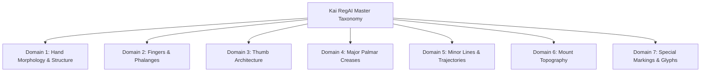

# Kai RegAI — Palm Feature Taxonomy & Ontology

## 1. Taxonomic Architecture Overview

The Kai RegAI Palm Feature Taxonomy organizes all observable and interrogable hand characteristics into six canonical domains:



---

## 2. Domain 1: Hand Morphology & Structure

| Feature Key | Sanskrit Term | Western Equivalent | Valid Categorical Values / Units | Detection Method | Classification & Epistemic Status |
|---|---|---|---|---|---|
| `hand.shape_elemental` | *Modern Synthesis* | 4 Elemental Types (Fred Gettings 1979) | `EARTH`, `AIR`, `FIRE`, `WATER` | `CV_DETECTABLE` | `MODERN_SYNTHESIS` (Western 20th c. geometric taxonomy) |
| `hand.shape_classical` | *Samudrika Varga* | 7 Hand Types (Cheiro / D'Arpentigny) | `ELEMENTARY`, `SQUARE`, `SPATULATE`, `PHILOSOPHIC`, `CONIC`, `PSYCHIC`, `MIXED` | `HYBRID` | `HISTORICAL_TEXT` |
| `hand.palm_aspect_ratio` | *Kara-tala Pramana* | Palm Width / Palm Length Ratio | Numeric ($0.80$ to $1.30$) | `CV_DETECTABLE` | Geometric measurement only (no inherent predictive claim) |
| `hand.finger_to_palm_ratio`| *Anguli-Kara Anupata* | Middle Finger Length / Palm Length | Numeric ($0.65$ to $1.05$) | `CV_DETECTABLE` | Geometric measurement only |
| `hand.texture` | *Sparsha / Tvak* | Skin Grain Texture | `VERY_FINE`, `FINE`, `MEDIUM`, `COARSE`, `ROUGH` | `USER_INPUT_REQUIRED` | Tactile observation |
| `hand.firmness` | *Mrdutva / Kathinatva*| Palmar Pad Firmness | `SOFT_FLACCID`, `ELASTIC_SPRINGY`, `FIRM_RESILIENT`, `HARD_UNYIELDING` | `USER_INPUT_REQUIRED` | Tactile observation |
| `hand.flexibility` | *Kara-Namrata* | Dorsal Bending Range | `STIFF` ($<10^\circ$), `STRAIGHT` ($\approx 0^\circ$), `FLEXIBLE` ($>25^\circ$), `HYPEREXTENSIBLE` | `USER_INPUT_REQUIRED` | Physical resistance measurement |

---

## 3. Domain 2: Fingers & Phalanges (*Anguli*)

| Feature Key | Finger Identity | Astrological / Sanskrit Ruler | Evaluated Properties | Measurement & Epistemic Nature |
|---|---|---|---|---|
| `fingers.index` | Index Finger | Jupiter (*Guru / Bṛhaspati / Tarjanī*) | Length relative to Ring finger, upright straightness, apex shape (`SQUARE`, `CONIC`, `SPATULATE`, `POINTED`). | Geometric ratio + traditional symbolic association |
| `fingers.middle` | Middle Finger | Saturn (*Shani / Madhyamā*) | Dominant hand axis, phalanx knot symmetry, vertical alignment. | Geometric coordinate axis |
| `fingers.ring` | Ring Finger | Sun / Apollo (*Surya / Anāmikā*) | Length compared to index finger (Digit Ratio 2D:4D). | **Pure geometric observation**. Traditional palmistry associates long Apollo with risk/radiance; no empirical scientific personality claims are asserted. |
| `fingers.little` | Little Finger | Mercury (*Budha / Kaniṣṭhikā*) | Tip reach relative to ring finger distal joint (High, Equal, Short); curvature. | Geometric length alignment |
| `fingers.spacing` | Interdigital Gaps | *Chidra / Vivara* | Webbing depth, gap at base when fingers extended. | Geometric boundary polygon |
| `fingers.joints` | Phalange Nodes | Knotty vs Smooth (*Sandhi*) | Smooth vs Knotty nodes. | Anatomical joint contour |

---

## 4. Domain 3: Thumb Architecture (*Aṅguṣṭha*)

The thumb is designated the supreme anchor of character in both *Hasta Samudrika* and Benham’s analysis.

```
       [Distal Phalanx 1]  ──> Willpower, Decisiveness (Ichhā Shakti)
              |
      [Inter-phalanx Crease] ──> Yava / Barley Seed Sign (Fortune / Buddhi)
              |
       [Middle Phalanx 2]  ──> Logic, Reasoning, Discernment (Tarka Shakti)
              |
       [Basal Mount (Venus)] ──> Vitality, Passion, Stamina (Prāna Shakti)
```

| Feature Key | Property | Permitted Values | Tradition Notes |
|---|---|---|---|
| `thumb.angle_of_setting` | Opening angle against side of palm | Narrow ($<45^\circ$), Medium ($45^\circ-70^\circ$), Wide ($>75^\circ-90^\circ$) | Classical: Wide indicates self-reliance; narrow indicates caution. |
| `thumb.flexibility_distal` | Bend of top joint under pressure | `STIFF_UNBENDING` ($0^\circ$), `MODERATE`, `SUPPLE_BACKWARD_CURVE` ($>30^\circ$) | Supple = generous, adaptable; Stiff = resolute, unyielding. |
| `thumb.phalanx_ratio` | Phalanx 1 (Will) vs Phalanx 2 (Logic) | `EQUAL_BALANCE`, `DOMINANT_WILL`, `DOMINANT_LOGIC` | Classical Benham and Shrimali consensus. |
| `thumb.yava_sign` | Barley sign on inter-phalangeal crease | `PRESENT_CLEAR`, `PARTIAL_CHAIN`, `ABSENT` | *Hasta Samudrika*: Highest auspicious sign for intellect and prosperity. |

---

## 5. Domain 4: Major Palmar Creases

| System Key | Sanskrit Name | Western Classical Name | Standard Color | Core Functional Domain |
|---|---|---|---|---|
| `lines.life_line` | *Pitri Rekha* / *Jeevan Rekha* | Life Line | **Violet** (`#A855F7`) | Physical vitality, constitutional stamina, lifestyle cadence |
| `lines.head_line` | *Matri Rekha* / *Mastak Rekha* | Head Line | **Blue** (`#00D2FF`) | Cognitive style, intellectual focus, mental resilience |
| `lines.heart_line` | *Ayush* / *Hridaya Rekha* | Heart Line | **Rose** (`#F43F5E`) | Emotional nature, empathy, relational attachment style |
| `lines.fate_line` | *Urdhwa Rekha* / *Bhagya Rekha* | Fate / Saturn Line | **Gold** (`#FBBF24`) | Vocational drive, sense of purpose, societal alignment |
| `lines.sun_line` | *Surya Rekha* / *Vidya Rekha* | Sun / Apollo Line | **Amber** (`#F59E0B`) | Creative self-expression, charisma, public renown |

### Universal Line Property Schema:
Every major line entity supports the following structured attributes:
* `presence`: `boolean`
* `continuity`: `CONTINUOUS`, `OVERLAPPING_BREAKS`, `CLEAN_BREAKS`, `CHAINED`
* `depth_class`: `DEEP_CLEAR`, `MODERATE`, `FAINT_THIN`, `BROAD_SHALLOW`
* `origin_location`: Anatomical anchor locus
* `termination_location`: Target mount or boundary
* `curvature_profile`: `STRAIGHT_LINEAR`, `GENTLE_SLOPE`, `WIDE_ARC`, `DEFLECTED`
* `terminal_branches`: `SINGLE`, `FORKED_BIFURCATED`, `TRIDENT_TRIFURCATED`, `TAIL_TASSEL`
* `internal_defects`: Array of `ISLAND`, `BAR_CROSSING`, `DOT`, `CROSS`

---

## 6. Domain 5: Minor Lines & Trajectories

| Line Key | Tradition Terms | Trajectory / Locus | Associated Meaning |
|---|---|---|---|
| `lines.mercury_health` | *Budha Rekha* / Hepatica | Base of palm upward to Mount of Mercury | Nervous and digestive vitality; commercial agility |
| `lines.marriage_union` | *Vivaha Rekha* | Lateral crease on percussion of Mercury mount | Significant emotional unions and commitments |
| `lines.mars_inner` | *Mangala Rekha* / Mars Line | Runs parallel inside the Life Line arc | Defensive vitality, inner stamina, guardian support |
| `lines.girdle_of_venus` | *Shukra Valaya* | Semicircular arc between Jupiter & Mercury | Heightened emotional and sensory receptivity |
| `lines.intuition` | *Uranius* / Line of Intuition | Curved sweep from lower Moon mount upward | Subconscious perception, spontaneous insight |
| `lines.ring_of_solomon` | *Guru Mudrika* | Semicircular band circling Mount of Jupiter | Philosophical wisdom, counseling aptitude |
| `lines.via_lascivia` | Passion Line | Lower palm horizontal branch | Sensory appetite, restless exploration |

---

## 7. Domain 6: Mount Topography (*Parvatas*)

The palm is partitioned into 8 traditional planetary sectors:

| Mount Key | Sanskrit Ruler | Anatomical Location | Attributes Assessed |
|---|---|---|---|
| `mounts.jupiter` | *Guru Parvata* | Beneath Index Finger MCP | Ambition, leadership, benevolence, spiritual confidence |
| `mounts.saturn` | *Shani Parvata* | Beneath Middle Finger MCP | Sobriety, contemplative discipline, solitary perseverance |
| `mounts.sun` | *Surya Parvata* | Beneath Ring Finger MCP | Aesthetic sensitivity, warmth, public illumination, optimism |
| `mounts.mercury` | *Budha Parvata* | Beneath Little Finger MCP | Eloquence, quick intellect, trade acumen, relational wit |
| `mounts.upper_mars` | *Urdhwa Mangala* | Percussion edge below Mercury | Moral fortitude, quiet endurance, resilience under stress |
| `mounts.lower_mars` | *Adho Mangala* | Webbing cavity inside thumb crook | Active courage, assertive initiative, physical boldness |
| `mounts.venus` | *Shukra Parvata* | Base pad of thumb inside Life Line | Vital force (*Ojas*), warmth, sensuality, empathy |
| `mounts.moon` | *Chandra Parvata* | Lower percussion opposite Venus | Subconscious depth, imagination, travel affinity |

---

## 8. Domain 7: Special Markings & Glyphs (*Lakshanas*)

### A. Classical Indian Sacred Glyphs (*Vedic Chihnas*)
* `markings.trident` (*Trishula*): Three-pronged branch, predominantly favorable on Jupiter or Saturn mounts; symbolizes victory and ethical ascendancy.
* `markings.fish` (*Matsya*): Oval with pointed tail, signifying divine preservation, prosperity, and spiritual intuition.
* `markings.lotus` (*Padma*): Petal-like configuration denoting purity and high philosophical orientation.
* `markings.temple_square` (*Mandira / Chatuskona*): Square enclosing mount or break, symbolizing sanctuary and protection from adversity.
* `markings.conch` (*Shankha*): Rare spiral mark denoting public renown and spiritual wisdom.

### B. Western Classical Markings (Benham / Cheiro)
* `markings.star`: Multi-point intersection concentrating mount energy (e.g. Star on Jupiter = fulfilled ambition; Star on Saturn = profound fated event).
* `markings.cross`: Two lines intersecting at right angles (e.g. Mystic Cross in quadrangle between Head and Heart lines = interest in esoteric and intuitive study).
* `markings.island`: Oval split in a line signifying temporary division or leakage of line energy.
* `markings.grille`: Cross-hatching showing obstruction or over-stimulation of mount energy.
* `markings.triangle`: Clean three-sided figure denoting focused intellectual or strategic mastery.
