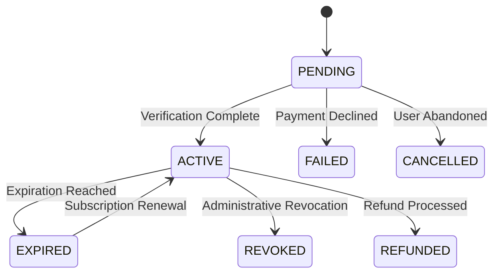
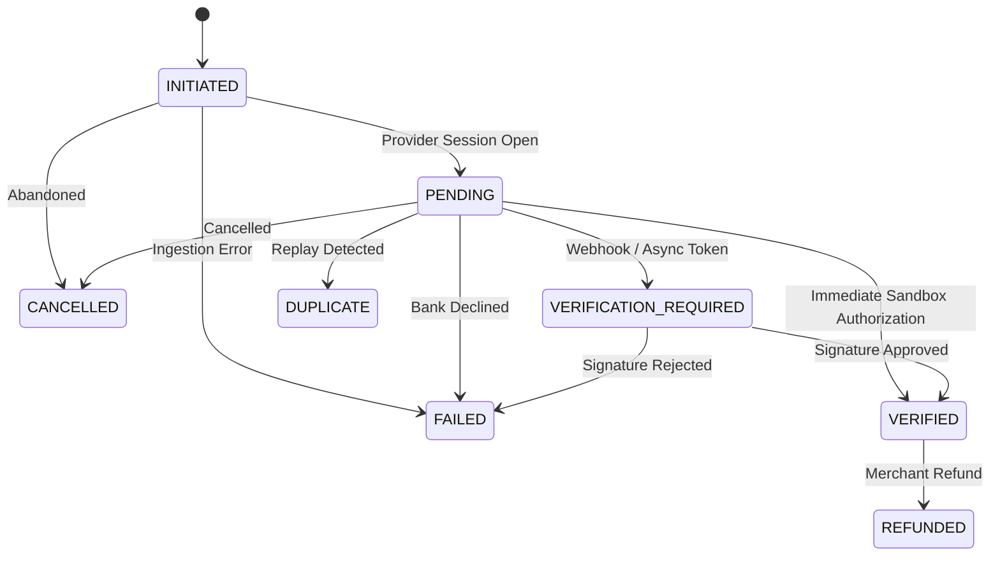

# KAI REGAI — P12 MONETIZATION & ENTITLEMENT ARCHITECTURE SPECIFICATION

**Product:** Kai RegAI  
**Descriptor:** PALM READING  
**Tagline:** The Story Written in Your Hands.  
**Phase:** P12 — Monetization & Entitlement Architecture  
**Document Version:** 1.0.0  
**Status:** AUTHORITATIVE & FROZEN  

---

## 1. Product Catalog

Kai RegAI defines a versioned, centralized, configuration-driven Product Catalog (`src/monetization/ProductCatalog.js`). No commercial SKUs or pricing rules are hard-coded in UI view components.

### Catalog Version: `1.0.0`

| Product ID | Tier | Display Name | Billing Type | INR | USD | EUR | GBP | Primary Capabilities |
|:-----------|:-----|:-------------|:-------------|:----|:----|:----|:----|:---------------------|
| `kai_free` | `FREE` | Free Palm Scan | Complimentary | ₹0 | $0 | €0 | £0 | Quick Scan, Optical HUD, Basic Lines |
| `kai_standard` | `STANDARD` | Standard Hastarekha Dossier | One-Time Purchase | ₹499 | $5.99 | €5.49 | £4.99 | 5-Line Telemetry, Chapters I & II, PDF Export, Mounts |
| `kai_premium` | `PREMIUM` | Master Premium Synthesis | One-Time Purchase | ₹999 | $11.99 | €10.99 | £9.99 | All 3 Chapters, Sacred Markings, Social Cards, High-Res Visualizer |
| `kai_annual_pass` | `PREMIUM` | Kai RegAI Annual Seeker Pass | Subscription (12 mo) | ₹2,999/yr | $34.99/yr | €31.99/yr | £28.99/yr | All Premium features, Continuous Archival Preservation |

---

## 2. Product Tiers

The system distinguishes three primary product tiers in a strict hierarchical order:

$$\text{FREE} \prec \text{STANDARD} \prec \text{PREMIUM}$$

- **FREE:** Baseline exploratory tier. Provides immediate visual delight, palm detection, optical quality HUD, and the concise Quick Report overview.
- **STANDARD:** Core chiromancy tier. Unlocks full 5-line isolated telemetry, Chapter I (Vocation) and Chapter II (Relationships), and print-ready PDF export.
- **PREMIUM:** Master reflective synthesis. Unlocks all three synthesis chapters (including Chapter III Contemplative Counsel), sacred Vedic markings, celestial mount depths, high-resolution SVG visualizer, and social export cards.

---

## 3. Entitlement Model

An **Entitlement** (`src/monetization/EntitlementSchema.js`) represents what a user or guest identity is permitted to access.

```text
Entitlement {
  schemaVersion: "1.0.0",
  entitlementId: "ENT-1727258400000-A1B2C3",
  ownerId: "GST-1727258000-XYZ" | "USR-1727259000-ABC",
  readingId: "RDG-100" | null,  // null for account-wide subscriptions
  productId: "kai_premium",
  tier: "PREMIUM",
  features: ["PREMIUM_REPORT", "ALL_CHAPTERS", "PDF_EXPORT", ...],
  status: "ACTIVE",
  source: "PURCHASE" | "PROMOTIONAL" | "ADMIN_GRANT" | "RESTORE",
  transactionId: "TXN-1727258400000-XYZ",
  grantedAt: "2026-09-25T15:00:00Z",
  expiresAt: null | "2027-09-25T15:00:00Z",
  revokedAt: null,
  metadata: { amount: 999, currency: "INR" }
}
```

### Core Invariant
$$\text{Transaction} \ne \text{Entitlement} \ne \text{Reading}$$
A transaction records what happened financially. An entitlement records what access was granted. A reading records the immutable chiromancy observation.

---

## 4. Transaction Model

A **Transaction** (`src/monetization/TransactionSchema.js`) records commercial purchase attempts and authorizations.

```text
Transaction {
  schemaVersion: "1.0.0",
  transactionId: "TXN-1727258400000-987654",
  provider: "MOCK" | "APPLE_STOREKIT" | "GOOGLE_PLAY" | "STRIPE",
  providerTransactionId: "MOCK-TXN-123456",
  productId: "kai_premium",
  ownerId: "GST-1727258000-XYZ",
  readingId: "RDG-100",
  amount: 999,
  currency: "INR",
  status: "VERIFIED",
  purchasedAt: "2026-09-25T15:00:00Z",
  verifiedAt: "2026-09-25T15:00:01Z",
  idempotencyKey: "IDEM-1727258400000-ABC",
  metadata: {}
}
```

### Zero-Credit-Card & Privacy Guarantee
`TransactionSchemaValidator` strictly scans and rejects any payload containing credit card numbers, CVVs, bank credentials, passwords, or raw palm images.

---

## 5. State Machines

### Entitlement State Machine (`src/monetization/EntitlementStateMachine.js`)


### Transaction State Machine (`src/monetization/TransactionStateMachine.js`)


---

## 6. Access Policy Engine (`src/monetization/AccessPolicy.js`)

Central authority for evaluating access. Replaces ad-hoc `if (isPremium)` checks.

### Input
- `ownerId`: Requester identity
- `readingId`: Target reading identifier
- `featureKey`: Requested capability from `FEATURE_KEYS`
- `entitlements`: List of owner's entitlements
- `asOfTime`: Verification timestamp

### Output
- `decision`: `ALLOW` | `DENY` | `PENDING` | `REQUIRES_PURCHASE` | `REQUIRES_VERIFICATION`
- `reason`: Auditable human-readable justification
- `requiredTier`: Minimum tier required
- `entitlement`: Matched active entitlement instance

---

## 7. Payment Provider Abstraction (`src/monetization/PaymentProvider.js`)

Provides an interface decoupling all business logic from payment rails:
- `createPurchase(purchaseIntent)`
- `getTransactionStatus(transactionId)`
- `verifyTransaction(transactionId, verificationPayload)`
- `restorePurchases(ownerId)`
- `handleWebhook(payload, signature)`

### Mock Payment Provider (`src/monetization/MockPaymentProvider.js`)
Supports deterministic test simulation modes:
`SUCCESS`, `PENDING`, `FAILED`, `CANCELLED`, `REFUNDED`, `DUPLICATE`, `TIMEOUT`.

---

## 8. Guest Purchase Architecture

Unauthenticated users with anonymous guest identities (`GST-...`) can purchase entitlements for their readings. Entitlements and transactions are bound to the guest ID in local storage.

---

## 9. Account Upgrade & Entitlement Migration

When a guest user registers or logs into an account (`USR-...`), `EntitlementService.migrateGuestEntitlements()` and `MockAuthProvider.upgradeGuestToAccount()` atomically reassign all guest-owned entitlements, transactions, and reading records to the new account identity.

---

## 10. Purchase Restoration

When a user installs the application on a new device or clears browser cache:
1. `EntitlementService.restorePurchases()` queries the payment provider for verified historical transactions.
2. Verified transactions are reconciled with local storage.
3. Matching entitlements are re-granted locally without re-charging the user.

---

## 11. Refund Handling & Reading Preservation

When a refund is processed:
1. Transaction transitions to `REFUNDED`.
2. Entitlement transitions to `REFUNDED` (revoked).
3. Access to premium features is revoked.
4. **CRITICAL INVARIANT:** The historical `ReadingRecord` is **NOT** deleted. The user retains their reading in history at the default Free access tier.

---

## 12. Expiration Handling

Subscriptions and promotional passes specify `expiresAt`. `Entitlement.isExpired()` computes validity deterministically. Once expired, `AccessPolicy` returns `REQUIRES_PURCHASE`.

---

## 13. Offline Policy

- Entitlements are stored locally in `IndexedDBStorageProvider` (with memory fallback).
- Active verified entitlements evaluate offline in **0.08 ms** with zero network calls.
- New transactions created while offline are queued in `SyncQueue` for reconciliation upon reconnection.

---

## 14. Security & IDOR Protection

- **No Client Trust:** Client UI boolean flags (`isPremium = true`) cannot grant authoritative access.
- **IDOR Protection:** `AccessPolicy` verifies that `entitlement.ownerId === requesterId` and `entitlement.readingId === targetReadingId`. User Eve cannot unlock User Alice's reading.
- **Idempotency:** `idempotencyKey` prevents duplicate transaction billing and double grants.

---

## 15. Privacy & Data Minimization

- Payment providers never receive raw palm photographs, landmark coordinates, or private questionnaire responses.
- Telemetry logs only safe commercial events (`checkout_started`, `purchase_completed`, `purchase_failed`).

---

## 16. Data Flow

```text
User Selects "Unlock Premium"
             │
             ▼
    PaywallModal (P12)
             │
             ▼
 EntitlementService.purchaseProduct()
             │
             ▼
 PaymentProvider.createPurchase()
             │
             ▼
 Transaction Stored (P11)
             │
             ▼
 Transaction Verified
             │
             ▼
 Entitlement Granted & Stored (P11)
             │
             ▼
 AccessPolicy.evaluate() == ALLOW
             │
             ▼
 DetailedReportScreen Reveals Full Chapters (P10)
```

---

## 17. P10 Report Engine Integration

- P10 remains the sole authority for report composition and rendering.
- `AccessPolicy.filterReport(reportModel)` creates a non-destructive presentation view model.
- Free users see the Overview and locked preview teasers for Chapters II & III.
- Premium users see all chapters fully revealed.
- The underlying `ReportModel` is never mutated.

---

## 18. P11 Storage Integration

`StorageProvider`, `MemoryStorageProvider`, and `IndexedDBStorageProvider` are extended with version 2 database object stores:
- `entitlements` store (indexed by `ownerId`, `readingId`, `status`)
- `transactions` store (indexed by `ownerId`, `status`, `idempotencyKey`)

---

## 19. Testing Strategy

- Complete P12 test suite: `tests/monetization/p12_monetization_engine.test.js` (37 tests).
- 15 Golden Commercial Cases: `tests/monetization/golden/goldenCommercialCases.js`.
- Full regression suite: 229 / 229 tests pass across 47 suites.

---

## 20. Future Payment Provider Readiness

The architecture is prepared for plug-and-play integration with:
- Apple StoreKit 2 (`AppleStoreKitProvider`)
- Google Play Billing (`GooglePlayBillingProvider`)
- Web Stripe Checkout (`StripePaymentProvider`)
No changes to P5–P11 or the core entitlement policy will be required when adding these providers.
