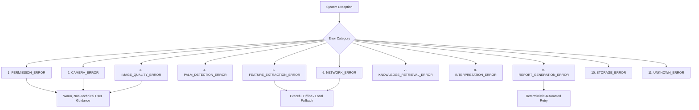

# Kai RegAI — Error Architecture & Recovery Specification

## 1. Error Taxonomy & User-Facing Recovery Matrix

To maintain high user trust and prevent confusing crashes, Kai RegAI categorizes all exceptions into a **unified 11-tier Error Taxonomy**:

---

## 2. Comprehensive Error Handling Ledger

| Error Code | Root Technical Cause | User-Facing Message Intent | Recovery Action & UI CTA | Telemetry & Logging Policy |
|---|---|---|---|---|
| `PERMISSION_ERROR` | Camera permission denied or restricted by OS parental controls. | *"Kai RegAI needs camera access to see the lines on your palm in real time. We never store photos without consent."* | Direct button opening device OS App Settings (`Linking.openSettings()`). | Log permission state event; zero PII. |
| `CAMERA_ERROR` | Hardware camera sensor locked by another app or hardware failure. | *"Camera preview unavailable. Please check that another app is not using your camera."* | In-screen *"Reload Camera"* CTA button. | Log hardware error code and device model. |
| `IMAGE_QUALITY_ERROR` | Excessive blur, extreme glare, or underexposure during capture. | *"The lighting seems too soft to read the fine lines. Let's try once more under gentle, steady light."* | Auto-resets camera guidance HUD; highlights torch button. | Log lighting histogram metrics. |
| `PALM_DETECTION_ERROR` | Hand leaves frame or wrist cannot be localized. | *"Hold your palm centered within the outline."* | Dynamic animated guidance arrows pointing to frame center. | No error log (standard interactive state). |
| `FEATURE_EXTRACTION_ERROR`| Major lines too faint to meet 0.70 confidence threshold. | *"We can see your hand clearly, but the line creases are soft. Let's adjust your hand angle slightly."* | Prompts user to tilt palm slightly toward light or proceed to Mode 2 questionnaire. | Log feature confidence matrix. |
| `NETWORK_ERROR` | Device offline during report narration request. | *"You appear to be offline. Your palm scan is saved safely on your device."* | In-app offline banner with *"Retry when connected"* CTA; cached report preview. | Log network timeout duration. |
| `KNOWLEDGE_RETRIEVAL_ERROR`| Rule query fails or DB schema mismatch. | *"Compiling your reading... Refreshing traditional records."* | Automated fallback to bundled offline local knowledge base snapshot. | Critical internal Sentry/Datadog log alert. |
| `INTERPRETATION_ERROR` | Contradictory rule condition deadlock in Rule Engine. | *"Synthesizing your reading..."* | Rule Engine activates default broad constitutional archetype; resolves deadlock. | Log rule conflict payload for knowledge audit. |
| `REPORT_GENERATION_ERROR` | AI Narration API rate limit or safety filter false-positive. | *"We are finalizing your reading chapters. This may take just a moment longer."* | Automated retry with secondary fallback narration template ($< 1.5\text{ s}$). | Log prompt payload and error response code. |
| `STORAGE_ERROR` | Device disk full when saving PDF or history. | *"Storage full. Please free up space on your device to save your PDF report."* | Prompts user to retry saving or share text summary directly. | Log available device storage bytes. |
| `UNKNOWN_ERROR` | Unhandled runtime exception or thread panic. | *"Something unexpected happened. Your reading is safe — let's pick up where you left off."* | Clean recovery button restarting session from last verified draft checkpoint. | Full stack trace to internal crash monitoring. |

---

## 3. The Zero Technical Stack Trace Policy

* **Strict Prohibition**: Under no circumstances should an unhandled runtime error screen, red-box alert, raw JSON payload, or technical stack trace (e.g. `NullPointerException`, `TensorFlowException`) ever be rendered to the user.
* **Friendly Fallback Shield**: All async network and camera calls are wrapped in defensive boundary shields (`ErrorBoundary`) that render an elegant obsidian-gold recovery screen with two simple actions: *"Try Again"* and *"Return to Home"*.
