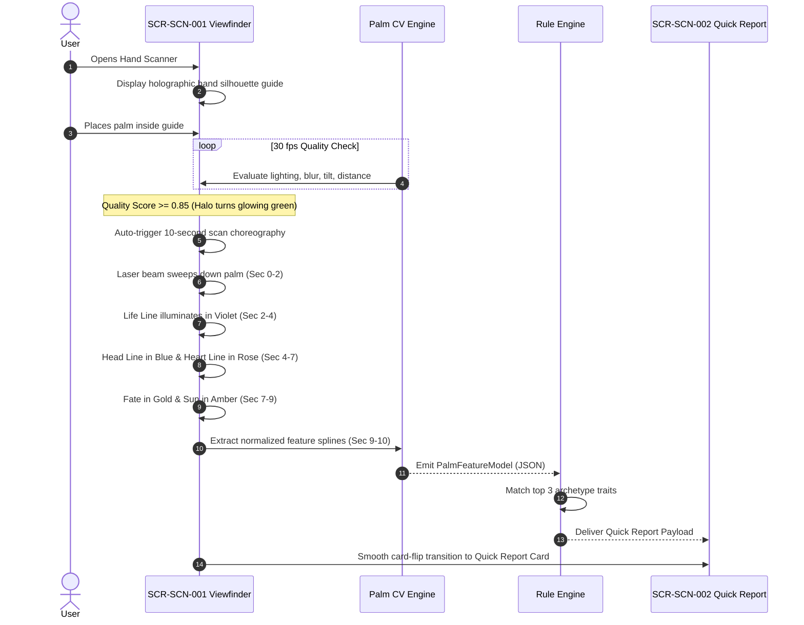

# Kai RegAI — Mode 1: Hand Scanner UX Flow

## 1. Flow Overview & UX Objective

The **Hand Scanner (Mode 1)** provides a lightning-fast, visually captivating palm reading experience in **approximately 10 seconds**.

* **Core Purpose**: Instant personal reflection, accessible exploration, and social sharing.
* **Strict Epistemic Invariant**: The Hand Scanner evaluates **only features that computer vision can directly detect** (`CV_DETECTABLE`). It never guesses or fabricates tactile properties (such as thumb stiffness or skin texture).



---

## 2. The 10-Second Choreographed Scan Timeline

The scanning experience is an intentional, choreographed visual narrative that demonstrates intelligence and reverence:

```
[0.0s ─── 2.0s] : Palm Perimeter & Alignment Lock
                  • Circular HUD snaps to palm contour.
                  • Luminous horizontal laser sweep begins descent from fingertips to wrist.
                  • Ethereal harmonic frequency audio tone.

[2.0s ─── 4.0s] : Vitality Cadence (Life Line Analysis)
                  • Laser hits radial crease between thumb and index.
                  • Life Line flares into brilliant VIOLET glow (#A855F7).
                  • HUD Status: "Tracing Vitality & Life Rhythm..."

[4.0s ─── 5.5s] : Cognitive Focus (Head Line Analysis)
                  • Laser sweeps across mid-palm transverse crease.
                  • Head Line ignites into electric BLUE glow (#00D2FF).
                  • HUD Status: "Mapping Thought Architecture..."

[5.5s ─── 7.0s] : Emotional Resonance (Heart Line Analysis)
                  • Laser reaches upper percussion pad beneath fingers.
                  • Heart Line ignites into radiant ROSE glow (#F43F5E).
                  • HUD Status: "Attuning Emotional Landscape..."

[7.0s ─── 8.0s] : Vocational Drive (Fate Line Analysis)
                  • Vertical median axis tracks upward toward Saturn mount.
                  • Fate Line illuminates in warm GOLD glow (#FBBF24) if detected.
                  • HUD Status: "Discerning Purpose & Direction..."

[8.0s ─── 9.0s] : Creative Radiance (Sun Line Analysis)
                  • Longitudinal track beneath Apollo mount evaluated.
                  • Sun Line flares in deep AMBER glow (#F59E0B) if present.
                  • HUD Status: "Illuminating Creative Expression..."

[9.0s ─── 10.0s]: Consolidating Palm Profile
                  • Full hand illuminates with all detected colored line splines.
                  • Subtle haptic double-pulse.
                  • Screen dissolves smoothly into 3D Quick Report Card.
```

---

## 3. The Palm Quality Gate Formula

To guarantee that readings are never generated from junk frames, the CV pipeline computes a continuous Composite Quality Score $Q \in [0.0, 1.0]$:

$$Q = 0.25 \cdot S_{\text{det}} + 0.20 \cdot S_{\text{sharp}} + 0.20 \cdot S_{\text{light}} + 0.15 \cdot S_{\text{pose}} + 0.10 \cdot S_{\text{dist}} + 0.10 \cdot S_{\text{occl}}$$

* **Minimum Scan Threshold**: $Q \ge 0.85$ sustained continuously for $\ge 500\text{ ms}$.
* **UX Feedback Rules**:
  * If $S_{\text{light}} < 0.60$: HUD displays *"Too dark — seek gentle lighting"* + Flashlight CTA.
  * If $S_{\text{dist}} < 0.60$: HUD displays *"Move hand closer"* or *"Move hand back"*.
  * If $S_{\text{pose}} < 0.60$: HUD displays *"Align hand vertically"*.
  * If $S_{\text{sharp}} < 0.70$: HUD displays *"Hold still"*.

---

## 4. Failure Recovery & Graceful Fallback

```
+─────────────────────────────────────────────────────────────+
|                     FAILURE RECOVERY MATRIX                 |
|                                                             |
|  Frame Interruption   ──> Pauses 10s timer, alerts user     |
|                           "Keep hand steady to resume"      |
|                                                             |
|  Hand Leaves Frame    ──> Resets laser sweep to top;        |
|                           returns to CAMERA_SEARCHING       |
|                                                             |
|  Low Line Contrast    ──> Applies local CLAHE enhancement;  |
|                           if still faint, skips line rather |
|                           than fabricating a trajectory     |
|                                                             |
|  Unrecoverable Error  ──> Gentle card: "We couldn't get a   |
|                           clear scan. Let's try once more   |
|                           with steady natural lighting."    |
+─────────────────────────────────────────────────────────────+
```

---

## 5. Quick Report Card Architecture (`SCR-SCN-002`)

* **Presentation**: An interactive 3D gyroscope-responsive card with obsidian-glass texture and glowing borders.
* **Component Layout**:
  1. **Top Header**: Date, hand analyzed (*Right / Dominant*), and Archetype Title (e.g. *"The Resilient Architect"*).
  2. **Center Media**: Rectified scan image of user's hand with the standardized glowing lines overlay (Violet, Blue, Rose, Gold, Amber).
  3. **Trait Highlights**: Three concise bullet points grounded in rule outputs:
     * *Heart*: Emotional attachment archetype.
     * *Head*: Reasoning and focus cadence.
     * *Life*: Vitality reserves and constitutional rhythm.
  4. **Contemplation Prompt**: A single reflective question for the day.
  5. **Actions**:
     * **Primary CTA**: *"Explore Full Guided Reading"* (launches Mode 2 using this palm scan as baseline).
     * **Secondary Actions**: *"Save to Readings"*, *"Share Card"*.
