# Kai RegAI — Information Architecture (IA) Specification

## 1. Top-Level Taxonomy & Content Tree

The Kai RegAI Information Architecture is structured around five primary content domains, accessible via a balanced bottom navigation system and contextual flow triggers:

```mermaid
graph TD
    Root[Kai RegAI Root IA]

    Root --> HomeDomain[1. Home Domain]
    HomeDomain --> WelcomeHeader[Welcome & Daily Reflection Greeting]
    HomeDomain --> ScannerHero[Hand Scanner CTA Card - Mode 1]
    HomeDomain --> DeepReadingHero[Palm Reading CTA Card - Mode 2]
    HomeDomain --> RecentReadingsSnippet[Recent Reading Quick-Link]
    HomeDomain --> WisdomOfDay[Traditional Palmistry Insight Snippet]

    Root --> ScannerDomain[2. Mode 1: Hand Scanner Domain]
    ScannerDomain --> CamViewfinder[Real-Time Camera Viewfinder & HUD]
    ScannerDomain --> QualityGuidance[Alignment & Lighting Guidance Engine]
    ScannerDomain --> ScanAnimation[Choreographed 10-Second Progressive Sweep]
    ScannerDomain --> QuickReportView[Quick Report Presentation Card]

    Root --> DeepDomain[3. Mode 2: Palm Reading Domain]
    DeepDomain --> HandContextSelect[Dominant vs Passive Hand Selection]
    DeepDomain --> BaselineCapture[Anatomical Baseline Camera Capture]
    DeepDomain --> InteractiveQuestions[Guided 5-Module Visual Questionnaire]
    DeepDomain --> DossierSynthesis[Synthesis & Narrative Generation HUD]
    DeepDomain --> DetailedReportView[Multi-Chapter Digital Palm Dossier]

    Root --> ReadingsDomain[4. Readings Archive Domain]
    ReadingsDomain --> HistoryList[Saved Readings Timeline]
    ReadingsDomain --> ComparisonTool[Left Hand vs Right Hand Comparator]
    ReadingsDomain --> ExportShareHub[PDF Download & Shareable Social Cards]

    Root --> LearnDomain[5. Learn Library Domain]
    LearnDomain --> LinesCategory[Major & Minor Palmar Creases]
    LearnDomain --> MountsCategory[The 8 Planetary Mounts]
    LearnDomain --> ShapesCategory[Hand Morphology & Elemental Types]
    LearnDomain --> TraditionsCategory[Vedic Hasta Samudrika vs Western Classical]

    Root --> ProfileDomain[6. Profile & Settings Domain]
    ProfileDomain --> AccountManager[Account & Hand Preference Settings]
    ProfileDomain --> PrivacyControls[Data Management & 1-Tap Deletion]
    ProfileDomain --> SubscriptionsHub[Premium Unlocks & Purchase Restoration]
    ProfileDomain --> LegalDisclaimers[Terms, Disclaimers & Ethics Policy]
```



---

## 2. Content Relationships & Cross-Domain Linkages

```
[Home Screen]
  ├── Tapping "Hand Scanner" ──────────> Launches Mode 1 Modal Flow
  ├── Tapping "Palm Reading" ──────────> Launches Mode 2 Modal Flow
  └── Tapping "Recent Reading" ────────> Opens Detailed Report in Readings Stack

[Quick Report (Mode 1)]
  ├── "Explore Full Guided Reading" ───> Enriches baseline scan into Mode 2 Questionnaire
  ├── "Save Reading" ──────────────────> Commits session to Readings Archive
  └── "Share Palm Card" ───────────────> Opens Export/Share Modal

[Detailed Report (Mode 2)]
  ├── "View Tradition Details" ────────> Cross-links into Learn Library topics
  ├── "Export Styled PDF" ─────────────> Generates multi-page printable report
  └── "Compare with Other Hand" ───────> Prompts Mode 2 scan for opposite hand
```

---

## 3. Data Ingestion vs. Interpretation Content Matrix

| Content Object | Ingestion Source | Output Destination | Epistemic Nature |
|---|---|---|---|
| **Raw Camera Frames** | Camera Sensor | Volatile Frame Buffer (RAM) | Transient biometric imagery; purged immediately after landmark extraction. |
| **Landmark Coordinates** | CV Engine (MediaPipe / CoreML) | `PalmFeatureModel.geometry` | Deterministic spatial points (pixels / normalized units). |
| **Crease Coordinates** | CV Edge Ridge Filter | `PalmFeatureModel.major_creases` | Normalized splines and curvature arcs. |
| **Tactile Observations** | Mode 2 Questionnaire | `PalmFeatureModel.user_observations` | User-reported physical properties (pad springiness, thumb bend angle). |
| **Matched Rules** | Knowledge Base Query | `InterpretationContext.verified_traits` | Literature-attributed hermeneutic claims. |
| **Narrative Chapters** | AI Narration Layer | `PalmReport.chapters` | Empathetic natural language prose reflecting matched rules. |
