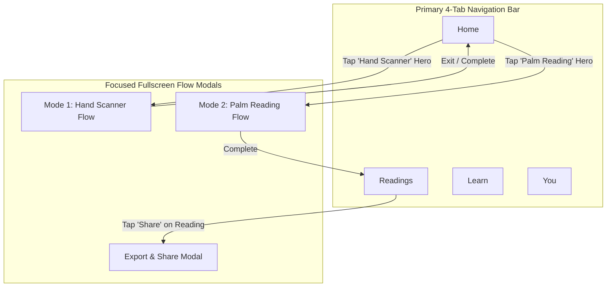

# Kai RegAI — Navigation Architecture Specification

## 1. Top-Level Navigation Model Evaluation

A foundational UX decision in P2 is the choice of primary navigation paradigm.

### Evaluation of Alternatives:
* **Option A: 5-Tab Bar with Center Camera Button (Standard Social/Scanner App)**
  * *Disadvantage*: Placing a single camera icon in the center creates severe ambiguity: does it trigger the ~10s Hand Scanner (Mode 1) or the deep Guided Palm Reading (Mode 2)? Users are forced into a sub-picker modal on every tap.
* **Option B: Drawer / Hamburger Navigation**
  * *Disadvantage*: Hides the Readings archive and Learn library behind low-visibility menus, depressing retention.
* **Option C: 4-Tab Bottom Navigation + Immersive Full-Screen Modals (Chosen Approach)**
  * *Structure*: **`Home`**, **`Readings`**, **`Learn`**, **`You` (Profile/Settings)**.
  * *Rationale*:
    1. **Clear Mode Differentiation**: The Home screen prominently presents the two reading experiences side-by-side as distinct, high-impact hero cards.
    2. **Immersive Focus**: Both the Hand Scanner and Palm Reading launch as dedicated, gesture-controlled full-screen modal flows (`ModalStack`), eliminating distracting tab bars during camera alignment and questionnaire input.
    3. **Ergonomic Thumb Reach**: Core navigation targets remain easily reachable with one hand.



---

## 2. Screen Stack & Route Hierarchy

```text
RootNavigator
├── OnboardingStack (First Launch Only)
│   ├── SCR-ONB-001: Splash & Brand Genesis
│   ├── SCR-ONB-002: Value Proposition & Two Reading Modes
│   └── SCR-ONB-003: Camera Permission Rationale & Primer
│
├── MainTabNavigator (Persistent Shell)
│   ├── HomeStack
│   │   └── SCR-HOM-001: Home Screen Hub
│   ├── ReadingsStack
│   │   ├── SCR-RDG-001: Readings Archive List
│   │   ├── SCR-RDG-002: Reading Detail Viewer (Quick or Detailed)
│   │   └── SCR-RDG-003: Left vs Right Hand Comparator
│   ├── LearnStack
│   │   ├── SCR-LRN-001: Learn Library Index
│   │   └── SCR-LRN-002: Topic Detail Article
│   └── ProfileStack
│       ├── SCR-PRF-001: Profile & Preferences
│       ├── SCR-PRF-002: Privacy & Data Management
│       ├── SCR-PRF-003: Subscription & Upgrades
│       └── SCR-PRF-004: Legal Terms & Ethics Policy
│
└── FlowModals (Full-Screen Presentation)
    ├── HandScannerStack (Mode 1)
    │   ├── SCR-SCN-001: Camera Viewfinder & HUD
    │   └── SCR-SCN-002: Quick Report Card
    │
    └── PalmReadingStack (Mode 2)
        ├── SCR-PLM-001: Dominant Hand Selector & Capture Primer
        ├── SCR-PLM-002: Baseline Anatomical Camera Viewfinder
        ├── SCR-PLM-003: Guided 5-Module Questionnaire
        ├── SCR-PLM-004: Narrative Synthesis Transition
        └── SCR-PLM-005: Detailed Palm Dossier
```

---

## 3. Back Navigation & Session Interruption Rules

| Flow & Screen | Android Hardware Back / iOS Swipe-Down Behavior | Cancellation Policy | Interrupted Session Handling |
|---|---|---|---|
| **Onboarding** | Inactive on Step 1; navigates to previous step on Step 2–3. | Cannot exit until primary choice made. | State persisted in local key-value store. |
| **Main Tabs** | Switches to `Home` tab; if already on `Home`, exits app on Android. | N/A | Preserves active scroll positions. |
| **Mode 1 Scanner Viewfinder** | Immediate dismissal of modal back to `Home`. | Camera session destroyed instantly; volatile frame buffers purged from RAM. | No draft saved (10s scan is ephemeral). |
| **Mode 1 Quick Report** | Dismisses modal back to `Home`; reading auto-saved to `Readings`. | Report persists in archive. | Retrievable via `Readings` tab. |
| **Mode 2 Questionnaire** | Prompts confirmation dialog: *"Exit Guided Reading? Your baseline scan is saved."* | If confirmed, session cached as draft for 24 hours. | User can resume from Home or Readings tab. |
| **Mode 2 Detailed Dossier** | Navigates back to `Readings` archive list. | Report permanently stored in user profile. | Fully cached for offline review. |

---

## 4. Deep Link & Notification Handling

The navigation router processes external URLs and local notifications using the canonical scheme `kairegai://`:

* `kairegai://scanner`: Bypasses home and immediately presents Mode 1 Hand Scanner.
* `kairegai://palm-reading`: Launches Mode 2 Palm Reading starting with hand selection.
* `kairegai://readings/:session_id`: Navigates directly to the specified reading in the archive.
* `kairegai://learn/:topic_slug`: Opens the specified educational article in the Learn tab.
