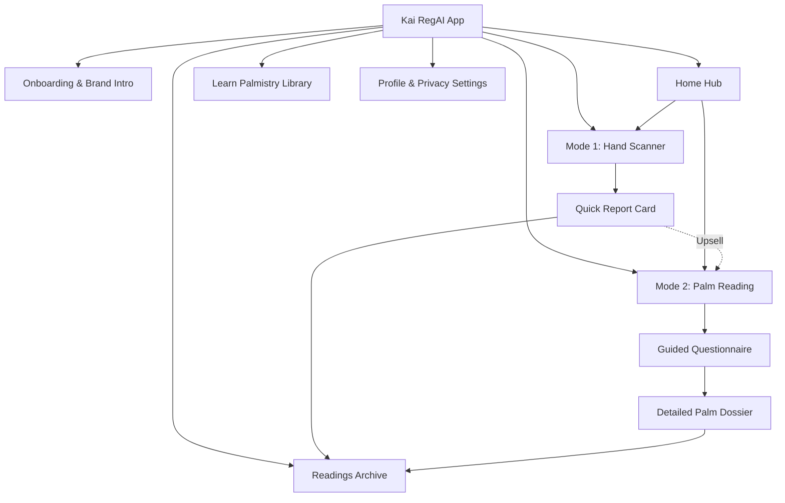

# Kai RegAI — P2 Product & UX Architecture Master Blueprint

## 1. Executive Summary & Product Vision

**Kai RegAI** is an AI-assisted palm-reading mobile application designed to harmonize **Ancient Indian Wisdom (*Hasta Samudrika Shastra*)**, **Modern Palmistry Frameworks**, and **Cutting-Edge Computer Vision & AI Narration**.

* **Product Descriptor**: PALM READING
* **Tagline**: *The Story Written in Your Hands.*
* **Core Brand Aesthetic**: *Ancient Indian Wisdom × Modern AI × Premium Technology*. A calm, mysterious, deeply elevated, and trustworthy product experience.

```
+─────────────────────────────────────────────────────────────────────────────────────────────+
|                                    CENTRAL SYSTEM INVARIANT                                 |
|                                                                                             |
|   USER EXPERIENCE ──> READING SESSION ──> PalmFeatureModel ──> KNOWLEDGE + RULES            |
|                                                                        │                    |
|                                                                        ▼                    |
|                                                                  INTERPRETATION             |
|                                                                        │                    |
|                                                                        ▼                    |
|                                                                  AI NARRATION               |
|                                                                        │                    |
|                                                                        ▼                    |
|                                                                     REPORT                  |
|                                                                                             |
|   1. The UI is NEVER the source of truth for palmistry facts.                               |
|   2. The CV Engine NEVER interprets symbolic meaning directly.                              |
|   3. The LLM NEVER receives a raw image or invents ungrounded palmistry interpretations.     |
+─────────────────────────────────────────────────────────────────────────────────────────────+
```

---

## 2. The Two Core Product Reading Modes

| Product Dimension | Mode 1: Hand Scanner | Mode 2: Palm Reading |
|---|---|---|
| **Primary Value Proposition** | Fast, visually delightful, instant reflection. | Deep, holistic, guided, multi-tradition synthesis. |
| **Target User Duration** | ~10 seconds total scan interaction. | 2–5 minutes guided interactive journey. |
| **Data Ingestion Modality** | Pure automated Computer Vision (`CV_DETECTABLE`). | Automated CV Baseline + Guided User Questionnaire. |
| **Observation Scope** | Major line trajectories, palm aspect ratio, finger lengths. | Hand morphology, thumb flexibility, mount pad firmness, sacred signs. |
| **Report Output** | Single-screen **Quick Report Card** with illuminated palm. | Multi-chapter **Detailed Palm Dossier** (in-app & exportable PDF). |
| **Monetization Fit** | Free top-of-funnel engagement and sharing. | Freemium / Premium tier or tokenized detailed reading. |

---

## 3. High-Level Product Architecture

The top-level structure of Kai RegAI organizes features into a logical hierarchy that prioritizes the two reading experiences while offering educational exploration and secure profile management:



---

## 4. Architectural Boundaries for Phase P2

Phase P2 is strictly an **architectural specification and UX contract**:
1. **Zero Production UI Code**: No JSX, CSS, Swift, or Kotlin application code is created in P2.
2. **Zero CV / ML Execution**: No camera device binding, OpenCV, or MediaPipe runtime implementations.
3. **Zero AI Inference / LLM Calls**: No prompt execution or dynamic text synthesis.
4. **Governed Knowledge Invariance**: P1 knowledge structures and schemas remain locked.
5. **Contract for Downstream Phases**: P2 produces the screen specifications for **P3 (Stitch UI Design)** and data contracts for **P5 (CV)**, **P7 (Questionnaire)**, and **P8 (Rule Engine)**.
