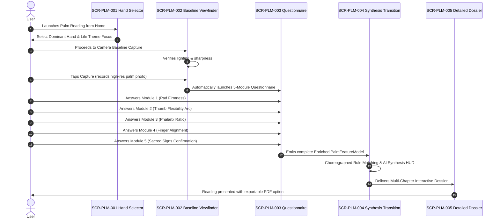

# Kai RegAI — Mode 2: Palm Reading UX Flow

## 1. Flow Overview & UX Objective

**Mode 2 (Palm Reading)** delivers the comprehensive, guided palmistry experience designed for **2 to 5 minutes** of contemplative engagement.

* **Core Purpose**: Deep, holistic self-reflection combining the best of Computer Vision with nuanced human tactile self-observation and multi-tradition synthesis.
* **Core Value**: Unlocks subtle traits that no 2D camera can discern (pad springiness, thumb bend resistance, fine sacred markings).



---

## 2. Hand Context & Dominance Selection (`SCR-PLM-001`)

Mode 2 begins by establishing the proper philosophical and anatomical orientation:
* **The Dominant Hand Concept**:
  * Clear educational note: *"Your Dominant hand reflects your conscious choices, ongoing effort, and current life path (*Kriyamana Karma*). Your Passive hand reflects your innate constitutional blueprint (*Sanchita Karma*)."*
* **Inquiry Focus Picker**:
  * Users can optionally select a life lens to highlight in the report:
    1. *Holistic Life Overview* (Default)
    2. *Vocation, Career & Calling*
    3. *Relationships, Empathy & Heart*
    4. *Vitality, Energy Rhythm & Resilience*

---

## 3. Baseline Anatomical Camera Capture (`SCR-PLM-002`)

* **Capture Mechanism**: Unlike Mode 1's automated 10-second sweep, Mode 2 captures a high-resolution, still anatomical baseline.
* **Quality Check**:
  * Evaluates lighting, focus, and hand flatness.
  * Captures the high-DPI frame and extracts 2D skeletal landmarks and major crease splines.
  * Immediately caches coordinates in volatile RAM; raw camera image is queued for temporary report rendering and purged upon session conclusion unless explicit consent is given.

---

## 4. Narrative Synthesis Transition (`SCR-PLM-004`)

Between the questionnaire and the dossier delivery, the user observes a 2–3 second choreographed synthesis transition:

```
[Phase 1]: "Correlating Hand Geometry with Classical Samudrika Principles..."
[Phase 2]: "Synthesizing Emotional and Cognitive Patterns..."
[Phase 3]: "Weaving Vedic Archetypes with Modern Characterology..."
[Phase 4]: "Your Personal Palm Dossier is Ready."
```

---

## 5. Detailed Palm Dossier Architecture (`SCR-PLM-005`)

The Detailed Dossier is organized as an editorial, multi-chapter digital book:
* **Cover & Executive Summary**: Personal archetype title, dominant elemental constitution (Earth/Air/Fire/Water), and key life themes.
* **Chapter 1: The Blueprint (Morphology & Thumb)**: Constitutional foundations, thumb willpower vs logic balance, hand shape interpretation.
* **Chapter 2: The Compass of the Heart (Heart Line)**: Emotional resonance, empathy style, relational attachment patterns.
* **Chapter 3: The Architecture of Thought (Head Line)**: Cognitive processing, analytical vs intuitive balance, focus cadence.
* **Chapter 4: The Current of Vitality (Life Line & Venus)**: Physical stamina reserves, restorative rhythm, lifestyle pacing.
* **Chapter 5: Destiny & Purpose (Fate & Sun Lines)**: Vocation direction, self-authored karma, creative radiance.
* **Chapter 6: Synthesis & Reflective Affirmation**: Unified personal guidance, mindful contemplation questions, and tradition cross-references.
* **Actions**: Export High-Resolution Styled PDF, save to Readings archive, share highlight card.
