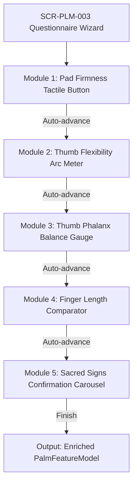

# Kai RegAI — Questionnaire Interaction Flow

## 1. Questionnaire UX Philosophy: Tactile, Visual & Adaptive

The Kai RegAI Guided Questionnaire replaces tedious text surveys with **intuitive visual instruments and tactile micro-interactions**.

```
+─────────────────────────────────────────────────────────────────────────────+
|                         QUESTIONNAIRE UX PATTERN                            |
|                                                                             |
|  [Tactile / Visual Prompt]                                                  |
|         │                                                                   |
|         ▼  (Interactive Manipulation: Drag, Slide, or Press)                |
|  [Dynamic Visual Feedback (Vector Bends, Pad Depresses, Silhouette Aligns)]  |
|         │                                                                   |
|         ▼  (Selection Confirmed)                                            |
|  [Light Haptic Confirmation Tick ──> Auto-Advance with Smooth Slide]        |
+─────────────────────────────────────────────────────────────────────────────+
```

---

## 2. Detailed Interaction Specifications for the 5 Modules



### Module 1: Mount Pad Firmness (`QST-PAD-FIRM-001`)
* **Prompt**: *"Gently press the fleshy base of your thumb (Mount of Venus). How does the pad respond?"*
* **Widget**: Interactive 3D silicone-textured pad button that physically depresses on touch screen.
* **Options**:
  1. `ELASTIC_SPRINGY`: Pad compresses and bounces back instantly $\rightarrow$ *Abundant vitality, expansive social warmth*.
  2. `FIRM_RESILIENT`: Pad is dense and muscular $\rightarrow$ *Steadfast physical stamina, athletic endurance*.
  3. `SOFT_FLACCID`: Pad yields gently and softly $\rightarrow$ *Receptive sensitivity, contemplative nature*.
* **Mapping**: `hand.morphology.firmness` $\rightarrow$ Rules `RULE-PAD-SPRINGY-001`, `RULE-PAD-FIRM-002`, `RULE-PAD-SOFT-003` (Sources: Benham, Shrimali).

### Module 2: Thumb Flexibility Radial Arc Meter (`QST-THUMB-FLEX-002`)
* **Prompt**: *"Gently press the top joint of your thumb backward. Does it bend easily or remain resolute?"*
* **Widget**: Dynamic vector illustration of a thumb connected to a radial curve slider ($0^\circ$ to $45^\circ+$).
* **Interaction**: As the user drags the slider, the on-screen thumb graphic visually bends in real time, demonstrating the bend angle.
* **Options**:
  1. `STIFF_UNBENDING` ($0^\circ - 10^\circ$): Resolute, highly disciplined, unyielding determination.
  2. `MODERATE_GENTLE` ($11^\circ - 25^\circ$): Balanced, open to reason with clear personal boundaries.
  3. `SUPPLE_FLEXIBLE` ($26^\circ - 45^\circ+$): Adaptable, generous, versatile, spontaneous.
* **Mapping**: `thumb.structure.flexibility_distal` $\rightarrow$ Rules `RULE-THB-STIFF-001`, `RULE-THB-SUPPLE-002` (Sources: Cheiro, Benham).

### Module 3: Thumb Willpower vs. Logic Balance (`QST-THUMB-PHALANX-003`)
* **Prompt**: *"Compare the length of the top nail segment of your thumb to the middle segment below it."*
* **Widget**: Stylized antique brass balance scale widget with touchable segment markers.
* **Options**:
  1. `EQUAL_BALANCE`: Both segments equal $\rightarrow$ *Harmony of conceptual reasoning and executive action*.
  2. `DOMINANT_WILL`: Top segment longer $\rightarrow$ *Drive, initiative, impulse to lead*.
  3. `DOMINANT_LOGIC`: Middle segment longer $\rightarrow$ *Deep deliberation, analytical scrutiny*.
* **Mapping**: `thumb.structure.phalanx_ratio` $\rightarrow$ Rules `RULE-THB-EQUAL-001`, `RULE-THB-WILL-002`, `RULE-THB-LOGIC-003` (Sources: Benham, Shrimali).

### Module 4: Finger Length Alignment Gauge (`QST-FINGER-RATIO-004`)
* **Prompt**: *"Compare your Index finger (Jupiter) and Ring finger (Apollo). Which extends higher toward the fingertips?"*
* **Widget**: Split-screen vector hand silhouette with adjustable horizontal reference laser line.
* **Options**:
  1. `RING_FINGER_LONGER`: Ring finger extends higher $\rightarrow$ *Creative expression, aesthetic charisma, calculated risk*.
  2. `INDEX_FINGER_LONGER`: Index finger extends higher $\rightarrow$ *Executive leadership, high personal standards, autonomy*.
  3. `EQUAL_LENGTH`: Both fingers equal height $\rightarrow$ *Balanced creative drive and organizational ambition*.
* **Mapping**: `fingers.proportions.index_to_ring_ratio` $\rightarrow$ Rules `RULE-FNG-APOLLO-LONG-001`, `RULE-FNG-JUPITER-LONG-002` (Sources: Benham, Varāhamihira).

### Module 5: Sacred Signs Confirmation Carousel (`QST-MARKS-CONFIRM-005`)
* **Prompt**: *"Do you observe any of these distinct traditional markings on your palm?"*
* **Widget**: Horizontal swipeable carousel of stylized glyph cards, each accompanied by an illustrative macro palm photo.
* **Cards**:
  * **The Fish (*Matsya*)**: Sign of auspicious resilience, protection near water/travel, spiritual intuition.
  * **The Trident (*Trishula*)**: Sign of victory, ethical ascendancy, and moral authority on Jupiter/Saturn.
  * **The Mystic Cross**: Independent cross in the central quadrangle denoting philosophical and intuitive contemplation.
  * **The Square of Protection (*Chatuskona*)**: Square enclosing a line break denoting preservation through major transitions.
* **Action**: Multi-select toggle (or *"None observed"* to skip).
* **Mapping**: `markings.glyphs.special_signs_confirmed` $\rightarrow$ Rules `RULE-MARK-FISH-001`, `RULE-MARK-TRIDENT-002`, `RULE-MARK-MYSTIC-003`, `RULE-MARK-SQUARE-004` (Sources: *Pāṇilekhā*, *Bṛhat Saṃhitā*, Benham).

---

## 3. Progressive Disclosure Architecture

To prevent question fatigue, the questionnaire employs **contextual gating**:
* If CV baseline capture already detected a long Apollo finger with confidence $\ge 0.92$, Module 4 pre-selects `RING_FINGER_LONGER` and displays: *"We noticed your ring finger extends prominent height — tap to confirm or adjust."*
* If CV baseline detected zero breaks in the Life line, the Square of Protection card is deprioritized in the carousel.
* Users can skip any question with zero penalty; the Rule Engine gracefully synthesizes from available features without guessing unconfirmed traits.
