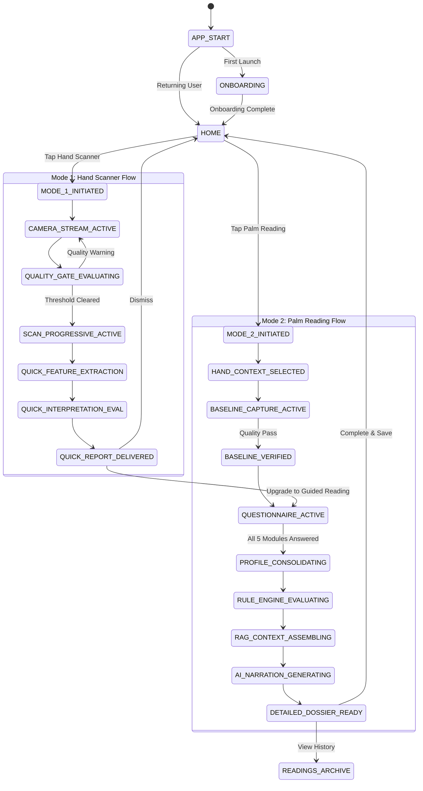
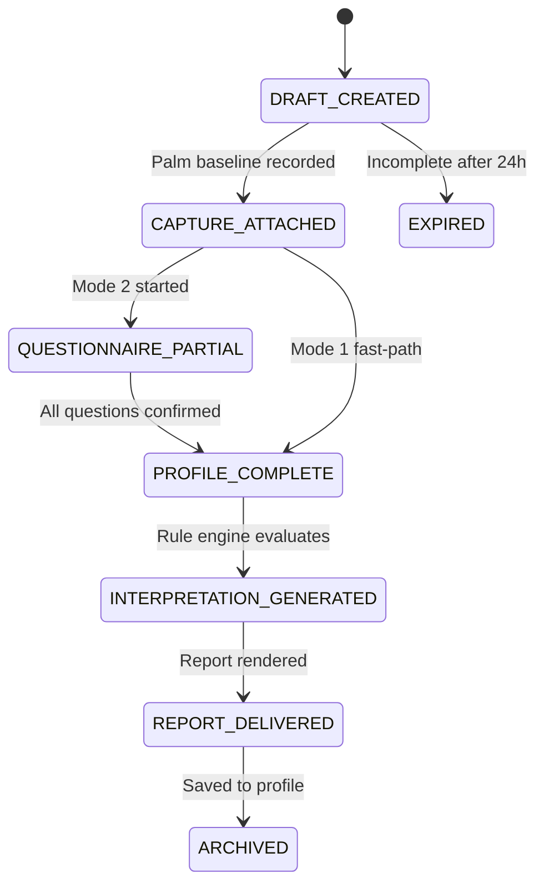
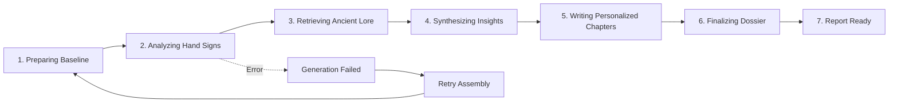

# Kai RegAI — State Machine Specifications

## 1. Global Application State Machine

The master application runtime transitions across these verified states:

---

## 2. Camera State Machine (20 Detailed States)

Every visual frame in the viewfinder triggers evaluation across this deterministic state machine:

| Camera State ID | Trigger Condition | Visual HUD Feedback | User Audio/Haptic Instruction | Recovery Action & Timeout |
|---|---|---|---|---|
| `CAMERA_INITIALIZING` | Hardware sensor booting. | Dark screen with subtle golden circular loader. | None. | Auto-transitions to `NO_HAND` upon first frame ($\le 800\text{ ms}$). |
| `CAMERA_PERMISSION_REQUIRED` | System permission not yet requested. | Fullscreen frosted modal explaining camera privacy. | None. | CTA: *"Allow Camera Access"*. |
| `CAMERA_PERMISSION_DENIED` | Permission explicitly denied. | Privacy fallback card with button to OS Settings. | None. | CTA: *"Open Settings"*. |
| `NO_HAND` | Zero hand landmarks detected in frame. | Holographic hand outline pulsing gently. | *"Place your palm inside the guide"*. | Auto-evaluates at 30 fps. |
| `HAND_PARTIALLY_VISIBLE` | $< 18$ of 21 landmarks detected. | Outline boundary turns amber. | *"Bring full hand into view"*. | Auto-evaluates. |
| `MULTIPLE_HANDS` | $\ge 2$ hand skeletons detected. | Red warning badge on secondary hand. | *"Please present only one hand"*. | Auto-evaluates. |
| `PALM_NOT_FACING_CAMERA` | Dorsal features (fingernails/knuckles) visible. | Red alert icon with flip-hand arrow. | *"Turn your palm toward the camera"*. | Auto-evaluates. |
| `HAND_TOO_FAR` | Palm area $< 25\%$ of viewfinder frame. | Inward-contracting amber arrow guides. | *"Move hand closer"*. | Auto-evaluates. |
| `HAND_TOO_CLOSE` | Palm area $> 75\%$ of frame; wrist clipped. | Outward-expanding amber arrow guides. | *"Move hand slightly back"*. | Auto-evaluates. |
| `HAND_ROTATED` | Palm vertical axis tilted $> 20^\circ$. | Rotational alignment guide brackets. | *"Hold your hand upright"*. | Auto-evaluates. |
| `LOW_LIGHT` | Mean luminance $< 30\%$ over palm ROI. | Amber bulb icon; flashlight button glows. | *"Seek brighter lighting or tap flash"*. | Manual CTA: Toggle Torch. |
| `OVEREXPOSED` | Specular glare $> 85\%$ across major creases. | Warning badge: *"Too much glare"*. | *"Angle hand away from direct light"*. | Auto-evaluates. |
| `BLURRY` | Laplacian sharpness variance $< \tau_{\text{sharp}}$. | Motion blur ripple icon. | *"Hold hand steady"*. | Auto-evaluates. |
| `PALM_OCCLUDED` | Shadow or fingers partially covering crease zone. | Amber hatching over obscured sector. | *"Uncurl fingers and clear palm"*. | Auto-evaluates. |
| `HAND_READY` | All 7 quality gates satisfied for $\ge 500\text{ ms}$. | Guide silhouette transforms into **glowing green halo**. | Light haptic confirmation tick. | Auto-initiates `SCANNING` (or enables scan button). |
| `SCANNING` | 10-second progressive choreography active. | Horizontal glowing laser sweep moving down palm. | Ethereal hum audio; haptic pulse. | Auto-progresses by second counter. |
| `ANALYZING` | Line crease features serializing into JSON. | Lines illuminate in **Violet, Blue, Rose, Gold, Amber**. | Sequential audio chimes. | Duration: $1.2\text{ s}$. |
| `COMPLETE` | Feature model successfully generated. | Palm pulse flash; screen fades to report transition. | Double haptic confirmation. | Transitions to `SCR-SCN-002`. |
| `ERROR` | Hardware dropped frames or unrecoverable CV crash. | Non-technical card: *"Unable to complete scan"*. | Gentle error haptic. | CTA: *"Try Again"*. |
| `RETRY` | User initiates re-scan after failure. | Resets viewfinder variables; re-engages camera stream. | None. | Resets to `NO_HAND`. |

---

## 3. Reading Session State Machine

The lifecycle of an individual reading session:

---

## 4. Report Generation State Machine

During Mode 2 dossier assembly, the user experiences a structured narrative assembly transition:

* **UX Feedback**: Each phase animates a status pill with culturally resonant copy (*"Translating Hasta Samudrika principles..."*, *"Weaving emotional and intellectual patterns..."*), maintaining engagement during the 2–3 second rule evaluation and AI generation window.
