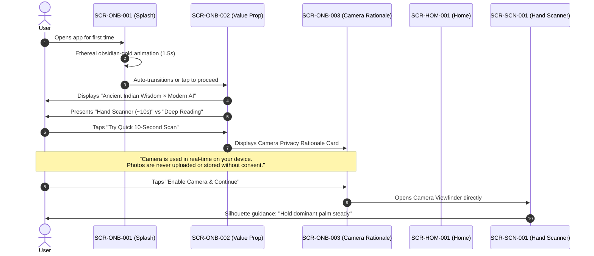
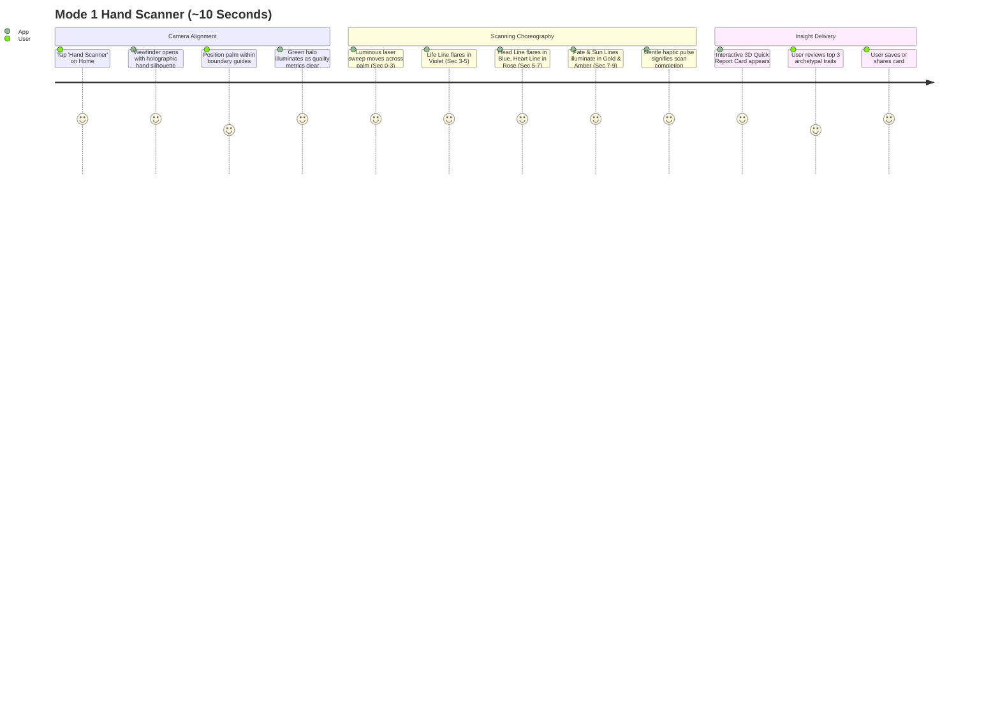
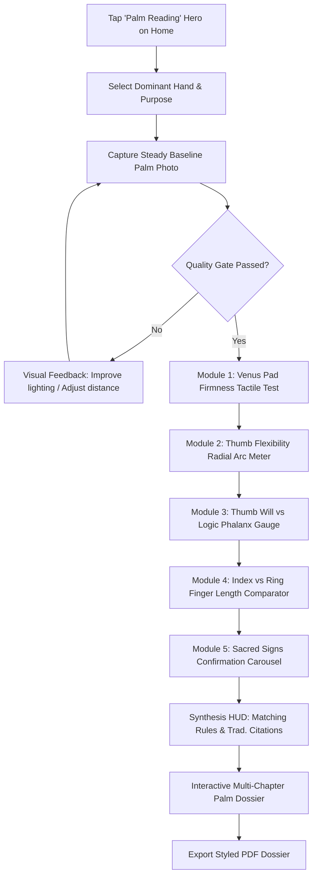

# Kai RegAI — User Journeys Specification

## 1. Journey Overview & Target Personas

Kai RegAI serves three core user intentions across distinct contexts:
1. **The Curious Explorer (Casual / First-Time)**: Wants immediate visual delight, fast gratification, and a zero-friction introduction to palm reading.
2. **The Mindful Inquirer (Deep Personal Reflection)**: Seeks introspective guidance, relationship insights, and authentic Vedic and classical perspective.
3. **The Heritage Student (Cultural / Educational)**: Enjoys learning the history of *Hasta Samudrika* and comparing hand signs.

---

## 2. Journey 1: First-Launch Experience (20–30 Second Onboarding)

* **Objective**: Introduce brand identity, clarify the two modes, obtain camera consent with high trust, and guide the user into their first reading.



* **First-Time Drop-off Mitigation**: If the user skips the initial scan, they land directly on the Home Screen with both reading hero cards prominent.

---

## 3. Journey 2: Mode 1 Hand Scanner (~10-Second Experience)

* **Context**: User on the move, at a gathering, or performing their daily reflective check-in.



---

## 4. Journey 3: Mode 2 Guided Palm Reading (2–5 Minutes)

* **Context**: User in a calm, contemplative environment exploring life transitions, relationship dynamics, or career pathing.



---

## 5. Journey 4: Reading History & Bilateral Comparison

* **Context**: User revisiting previous readings to reflect on personal evolution or compare the dominant (active) hand with the passive (innate) hand.

```
[Open Readings Tab]
        │
        ▼
[Readings Timeline List: Sorted by Date & Hand Type]
        │
        ├── Select Single Reading ──> Opens Full Report Viewer
        │
        └── Tap "Compare Hands" ────> Launches Bilateral Comparator:
                                      • Left (Innate Blueprint) vs Right (Active Trajectory)
                                      • Highlights divergence in Head Line & Fate Line
                                      • Summarizes conscious growth vs latent potential
```
