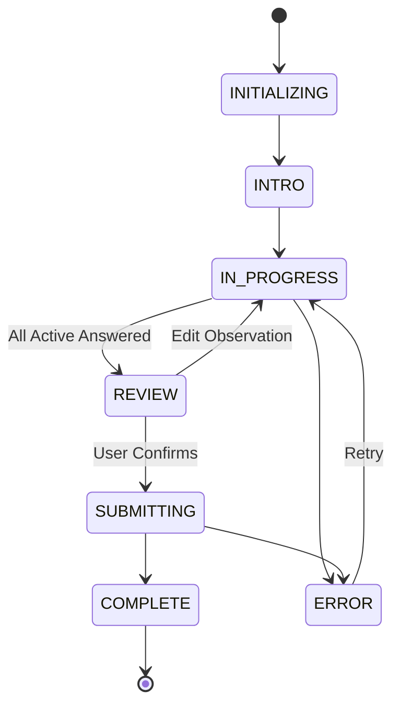

# P7 — Palm Reading Questionnaire Engine Architecture

**Product:** Kai RegAI  
**Descriptor:** PALM READING  
**Tagline:** *The Story Written in Your Hands.*  
**Phase:** P7 — Palm Reading Questionnaire Engine (Mode 2)  
**Status:** COMPLETE & VERIFIED  

---

## 1. Architectural Mandate: Unidirectional Convergence

The core architectural requirement of Kai RegAI is that **Mode 1 (Rapid Camera Scan)** and **Mode 2 (Guided Palm Reading Experience)** converge into the exact same downstream interpretation, reporting, and archiving architecture:

```text
                    KAI REGAI
                        │
              ┌─────────┴─────────┐
              │                   │
           MODE 1              MODE 2
        Camera Scanner       Guided Reading
              │                   │
          P5/P6 CV             P7 Engine
              │                   │
              └─────────┬─────────┘
                        │
                        ▼
              Canonical PalmFeatureModel
              (Schema v2.0.0 with Provenance)
                        │
                        ▼
             PalmInterpretationEngine
             (4 Epistemic Tiers, Zero Fatalism)
                        │
                        ▼
                   Quick Report
                        │
                        ▼
                 Detailed Report
```

There is strictly **ONE** downstream interpretation system. Mode 1 and Mode 2 generate identical canonical structures conforming to `PalmFeatureModel` (v2.0.0).

---

## 2. P7 Component Hierarchy

```text
src/questionnaire/
├── QuestionnaireSchema.js          # Authoritative question items, types, categories, and showWhen rules
├── QuestionnaireStateMachine.js    # 7-state finite state machine with strict/permissive validation
├── QuestionnaireEngine.js          # Headless controller: branching, progressive disclosure, stale pruning
├── QuestionnaireFeatureAdapter.js  # Maps raw responses -> PalmFeatureModel & handles CV reconciliation
└── index.js                        # Unified module exports

src/components/
└── QuestionnaireHUD.js             # UI presentation: question card, neutral illustration, progress, review, synthesis

src/services/
└── PalmInterpretationEngine.js     # Unified 4-tier epistemic synthesizer (Physical, Western, Vedic, Kai RegAI)

src/screens/
├── GuidedReadingScreen.js          # Pathway entry (Mode 1 Camera vs Mode 2 Guided Questionnaire)
├── QuestionnaireScreen.js          # Main questionnaire controller screen
├── QuickReportScreen.js            # Unified summary report (Method badge, observation confidence, lines)
└── DetailedReportScreen.js         # Comprehensive 4-tab dossier (Overview, Lines, Mounts & Marks, Synthesis)
```

---

## 3. Finite State Machine (`QuestionnaireStateMachine.js`)

The engine operates on a strictly validated 7-state lifecycle:



### State Definitions:
1. `INITIALIZING`: Engine instantiates, applies initial answers (e.g. hand selection), and prunes invalid defaults.
2. `INTRO`: Educational orientation screen explaining neutral observational chiromancy.
3. `IN_PROGRESS`: Progressive step-by-step disclosure of active questions.
4. `REVIEW`: Comprehensive review of all recorded observations with 1-tap edit jump buttons.
5. `SUBMITTING`: Non-blocking synthesis transition screen with sacred geometry and status updates.
6. `COMPLETE`: Successful handoff to canonical feature model and report navigation.
7. `ERROR`: Graceful error boundary state with recovery retry.

---

## 4. Headless Execution Engine (`QuestionnaireEngine.js`)

The engine decouples application logic from DOM rendering:
- **Progressive Disclosure**: Calculates active question count and progress percentage dynamically based on satisfied dependencies.
- **Immediate Stale Answer Pruning**: When a user changes an answer to an ancestral question (e.g., changes `life_line_visibility` from `CLEAR` to `NOT_VISIBLE`), all dependent morphology answers (`life_line_continuity`, `life_line_curvature`) are immediately pruned.
- **Direct Navigation (`goToQuestion`)**: Allows instantaneous editing from the review screen, transitioning back to `IN_PROGRESS` at that specific question.
- **Review Summary Compilation**: Maps internal question IDs and enum codes into human-readable question titles and option labels.

---

## 5. Provenance & Conflict Reconciliation

When both Mode 1 (CV) and Mode 2 (Questionnaire) observations exist, `QuestionnaireFeatureAdapter.reconcile(cvModel, questModel)` applies a deterministic, non-destructive policy:
1. **Sensory Priority**: Tactile/morphological traits (palm firmness, thumb flexibility angle) prioritize the user's manual observation.
2. **Optical Preservation**: Physical polyline coordinates from CV are retained for SVG overlay rendering.
3. **Line Enrichment**: If CV classified a crease as `NOT_DETECTED` due to optical lighting/glare, but the user confirmed its presence through guided observation, the line status is upgraded to `PARTIAL` with a clear audit provenance note.
4. **Epistemic Label**: Provenance is tagged as `HYBRID_FUSION` with `source: 'FUSED'`.
